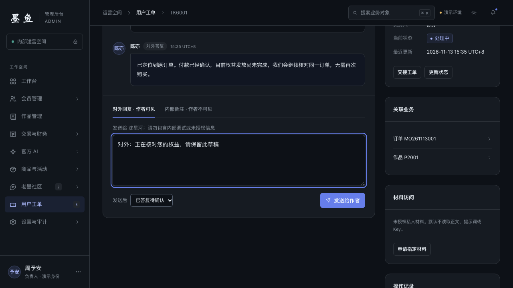
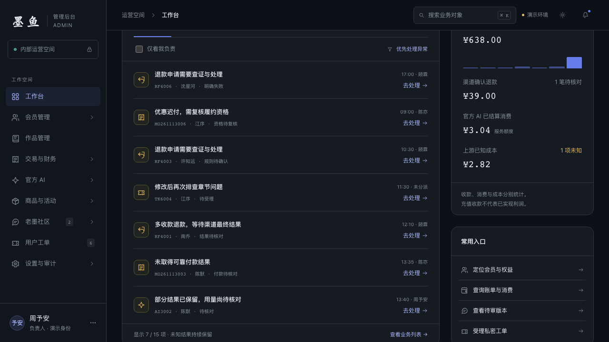
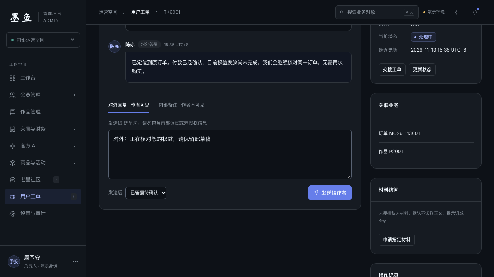

# 墨鱼管理后台：五条核心流程交互与异常恢复检查

2026-11-13（UTC+8）。检查对象为本项目 `index.html`，浏览器目标 `http://127.0.0.1:4179/index.html`。依据跨端关键流程 F01–F05 / PF-01–PF-15，采用 Standard 范围，探索预算 900 秒。项目是原生 HTML / JavaScript 原型，没有 Git 仓库或原有测试框架；本次未安装依赖、提交代码或接入真实业务。

**结果：发现并修复 3 项问题，新增 5 项恢复回归测试，最终全部通过。五条流程均检查了关键路径及异常分支；以下逐项列出实际覆盖，未将部分检查表述为完整验收。**

## 五条流程的实际结果

| 流程 | 已实际操作或核对的结果 | 覆盖限制 |
|---|---|---|
| F01 支付与履约 | MO261113001：已付款待恢复→填写原因→权益到账，刷新保留业务事实。003：查询超时保留原状态和核对时间，再查同一付款仍待核对。006：迟付且无名额走原实付 ¥39 退款。007：额度发放记录从 0→1，重复恢复仍为 1，并提示不满足恢复条件。 | 未对所有订单做跨标签同时补发及角色切换后的提交组合测试；未真实调用支付渠道。 |
| F02 AI 费用争议 | AI3001：原消费 ¥1.80 保留，更正 +¥0.90，净消费 ¥0.90。3002：补取用量后仍待核对，已交付结果、¥0.64 已结算与 ¥1.20 预占保留。3003：页面展示作者授权 / 消费 ¥1.50，上游 ¥1.92，平台承担 ¥0.42。3004：自备 Key 仅展示 ¥0.84 估算，官方消费为 0。3005：失败无可用结果，作者消费为 0，平台成本 ¥0.18。 | 3003–3005 为页面与预置状态核对，未实际执行 AI 或结算服务。补偿审批未全程复查。 |
| F03 退款与冲正 | RF4002：批准→执行→查询原退款，资金 ¥39 已退、无需冲正、完成。4001：查询后仍结果未知，保留原请求。4003：D05 未决，保留 ¥35 预留，不开放审批执行。4004：资金已退后仅恢复权益冲正，扣对应来源 ¥20 并释放 ¥20 预留。4006：明确失败后重新核验，预留从 0→20，回到已批准 / 未执行。 | 4006 复查止于重新预留，未再次执行到到账。未验证真实渠道重试、回调乱序、渠道幂等或账务事务。 |
| F04 发帖审核 | RV5001：退回 v2 保留公开 v1；作者修改重提 v3，旧理由留在历史。第二标签撤回 v3 后，第一标签提交旧审批被拦截，提示对象已更新。RV5003：作者无参与权时，通过 / 退回按钮禁用。 | RV5004、5006 的全部管理隐藏 / 恢复组合未逐项实操；无服务端权限或并发验收。 |
| F05 工单与材料授权 | TK6001：内外草稿分离、内部发送不清空对外草稿、刷新恢复。TK6003：只读指定 v3 片段；作者撤销后再访问被阻止。TK6006：关联退款未知时，状态操作不提供“已解决”。TK6005：作者继续反馈，工单从待确认回到处理中，反馈保留。作者对照不显示内部消息。 | 授权自然到期、材料已打开期间跨标签撤销、所有转派职责组合未全部实操。 |

首轮主要通过页面按钮、输入和作者对照操作；补查部分使用浏览器内已有公开控制器触发操作，并核对实际页面 / 业务状态。未增加绕过权限的测试接口。

## 修复的问题

### ISSUE-001：内部备注与对外回复共用草稿

严重性：Critical，功能类；原型中存在将内部草稿误发给作者的风险。

复现：TK6001 输入对外答复→切内部备注并输入内部信息→切回对外，内部文字仍出现在可对外发送的输入框。原实现保存内部备注还会清空其他受众的未发草稿。

修复：草稿按员工、工单、受众分别保存；切换恢复对应草稿；发送仅清空当前受众。作者对照继续过滤内部消息。变更文件：`assets/app.js`、`assets/support-actions.js`、`assets/support-details.js`。

修前：

修后：

### ISSUE-002：刷新丢失工作位置、筛选与未发送输入

严重性：Critical，功能类；未发送文本会丢失，需人工重新录入。

复现：进入工单详情、输入答复并刷新，退回工作台且草稿丢失。修复补查还发现只输入列表搜索条件、没有其他操作时立即刷新仍丢失筛选；已补充独立用例并修复。

修复：工作现场与共享业务数据分别存储，恢复当前对象、页签、返回记录、筛选、未发回复及发送后状态；列表搜索和分页即时保存。存储不可用时保留当前页内存操作并显示恢复能力受限提示。变更文件：`assets/app.js`、`assets/views.js`、`assets/support-details.js`。

修前：

修后：

### ISSUE-003：刷新自动恢复负责人身份，退出状态丢失

严重性：Medium，功能类；这是本地演示身份问题，不能据此认定真实系统存在提权。

复现：切换客服身份后刷新，自动回到负责人；退出后刷新自动进入后台。

修复：恢复当前演示员工与退出状态，员工之间草稿隔离。变更文件：`assets/app.js`。浏览器回归验证客服刷新仍为客服，退出后刷新仍处于未登录展示。

三项均已修复并定向验证，没有已确认但未修复的问题；未覆盖分支不计作“通过”。

## 回归与证据

永久回归文件：`tests/recovery.regression-1.test.py`。Python 标准库驱动 gstack 浏览器，使用独立随机本地端口、合成数据与自建标签页，结束清理自身资源。

| 用例 | 最终结果 |
|---|---|
| 内部与对外草稿分别恢复 | 通过 |
| 刷新恢复业务、筛选、未发回复、发送后状态和返回点 | 通过 |
| 内部发送不清空或公开对外草稿 | 通过 |
| 单独修改搜索条件后立即刷新仍恢复 | 通过 |
| 员工草稿隔离、身份刷新保留、退出刷新不自动进入 | 通过 |

最初 4 项用例修前均失败，记录在 `regression-red.txt`；修后 4 项通过见 `regression-green.txt`。新增搜索用例首次沿用已有相同搜索值，形成无效绿灯，该次记录 `regression-filter-red.txt` 不作为修复证明；改用独立值后失败见 `regression-filter-red-confirmed.txt`，最终 5 项通过见 `regression-final-green.txt`。

关键补查：`probe-046.json` 为内外切换、刷新、截图和控制台；`probe-047.json` 为自备 Key；`probe-048.json` 为唯一发放、失败退款重核、费用边界和无权审核；`probe-049.json` / `probe-050.json` 为未知结果保持与作者继续反馈；`probe-051.json` 控制台为 `(no console errors)`。其他首轮证据保留于同目录。

`screenshots/issue-002-result.png` 是**旧审批被成功拦截**的通过证据，历史文件名并不表示 ISSUE-002 缺陷。截图均已读取检查。记录中的 CLI 选择器多匹配、弹窗遮挡或脚本超时属于工具操作失败，不计为产品控制台缺陷。`chain` 日志包含步骤输出，但记录器未单独保存 stdin，不能把每条探索记录宣称为可直接重放脚本。

## 评分与完成边界

仅对本轮功能检查与控制台给出暂定分数，排除未完整测试的链接、视觉、可访问性、性能、内容及 UX。修前功能分 42、控制台 100，按 20% / 15% 权重归一为 67；修后已覆盖检查无未解决问题，暂定 100。**该分数仅表达已覆盖检查中的问题修复情况，不代表全站质量或生产上线准备度。**

未进行完整的 1024px、四主题、键盘与读屏回归、浏览器兼容性、存储拒绝故障注入、自然过期和所有跨标签组合。真实认证、逐操作授权、退款与发放幂等、账务原子性、回调乱序、私人材料撤销后的服务端阻断，仍需在真实实现上验证。

本次恢复使用同标签页会话存储；关闭标签页后的草稿恢复没有承诺。共享业务数据仍采用本地存储，不能替代多用户并发后端。D01–D10 仍未定案；所有账号、资金、材料及操作均为本地合成演示。原型无需联网业务请求，此检查没有发生真实收款、退款、AI 调用或对外消息发送。
