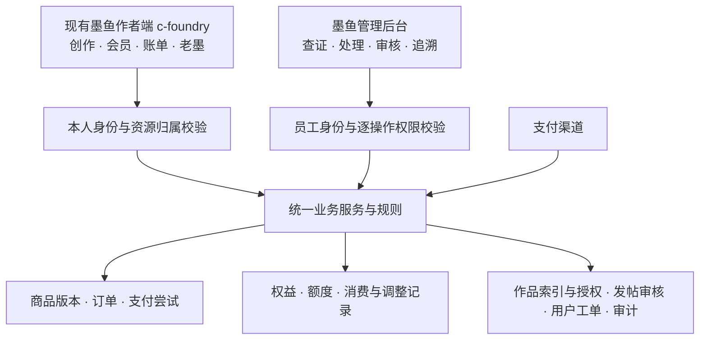

# 墨鱼管理后台设计 Brief

> 版本：v0.2｜日期：2026-11-09｜状态：设计评审稿
>
> 上游：[上市发布 PRD v0.3](commercial-launch-prd.md)。本文把 PRD 转为后台设计输入，不代表其中的待决商业规则已获批准。
>
> 作者端功能与验收：[作者端上市 PRD](author-launch-prd.md)。
>
> 配套：[页面地图](admin-page-map.md) · [跨端业务流程](commercial-cross-app-flows.md) · [作者端设计建议](author-commercial-design.md)

## 1. 产品关系与本次授权

**墨鱼就是现有 c-foundry 项目的作者端。** 会员、官方 AI、支付、账单、商业活动和老墨均围绕现有产品扩展；作者仍在熟悉的作品与创作空间中完成写作。

管理后台是墨鱼运营人员处理用户服务、交易、费用和社区事务的独立工作空间。它与作者端操作同一笔业务，区别在于使用者、权限、展示信息和可执行动作。

| 层次             | 本轮设计建议                                              | 与现有项目的关系                                                         |
| ---------------- | --------------------------------------------------------- | ------------------------------------------------------------------------ |
| 作者产品         | 墨鱼                                                      | 就是当前 c-foundry 作者端，在现有页面和导航上增量设计                    |
| 内部界面         | 墨鱼管理后台                                              | 独立登录入口与运营导航，服务墨鱼的业务                                   |
| OpenDesign Cloud | 作者端沿用现有 `c-foundry` 设计项目；后台使用独立设计项目 | 共同遵守墨鱼设计规范；独立设计项目用于组织不同使用者的页面               |
| 前端工程         | 后台独立应用为建议，候选为同仓 `apps/admin`               | 不是新建另一个作者端，也不要求另开代码仓库；工程结构在 OpenSpec 阶段定案 |
| 服务和数据       | 建议复用现有 NestJS 服务体系，分开作者与后台接口及权限    | 商品、订单、权益、用量和社区对象各有统一规则，不能各端各维护一份         |

用户已要求按建议推进设计准备，并明确墨鱼即当前作者端。本次补充会员、订单、作品、费用账单、会员账户、发帖审核、用户工单及作者端对应设计，交付仍限于规划文档；PRD §15 D01–D10 仍待逐项裁决。本文不修改范围政策，不创建生产入口或数据模型。

当前实现的静态事实沿用 [2026-11-08 证据记录](commercial-launch-evidence.md) 的适用范围；下面的模块、路径和状态都是目标设计，不作为现有功能声明。

## 2. 后台优先解决的任务

后台首先要让运营者回答“发生了什么、依据是什么、我能做什么、作者会看到什么”。首页优先展示待办，业务详情负责证据和处置，成功反馈来自可核对的业务结果。

| 任务        | 起点                               | 后台应能完成                                           | 作者端结果                                 |
| ----------- | ---------------------------------- | ------------------------------------------------------ | ------------------------------------------ |
| 付款未到账  | 作者提供订单号，或系统出现履约待办 | 查渠道付款、确认是否已发放、重试未完成履约             | 同一订单显示已付款、发放进度或已到账       |
| AI 费用争议 | 本次动作的费用详情或用户工单       | 区分来源、授权、执行、消费和上游成本；更正有误账项     | 同一动作显示可解释费用、调整记录和处理结论 |
| 退款        | 作者申请，或多收款等异常触发       | 核对可退范围、预留、审批、原路退款、跟踪结果与权益冲正 | 显示退款处理进度、相关额度和权益变化       |
| 老墨管理    | 举报或作者复核申请                 | 查看社区内容及上下文，隐藏、恢复或限制互动             | 可见具体理由及复核入口，私人写作不受误伤   |

用户补充后，首轮原型扩展到会员、会员账户、作品、订单、费用账单、发帖审核和用户工单。除前三条资金流程，还须走通发帖提审与退回重提、私密工单与作品材料授权。原型可分批制作，整轮评审须覆盖这七项能力；其他复杂设置再细化。

### 2.1 七项功能的定义

| 功能     | 管理对象与操作                                                                     | 作者端对应                                 |
| -------- | ---------------------------------------------------------------------------------- | ------------------------------------------ |
| 会员管理 | 全部注册作者、账号与免费／试用／付费权益状态、续期／到期及历史；固定权限内处理权益 | 作者中心、会员与续费、账户设置             |
| 会员账户 | 购买／赠额／补偿、可用、任务预占、退款预留、到期与变动来源                         | 费用账单内的额度账户                       |
| 订单     | 商品快照、付款尝试、履约、退款、票据和关联工单                                     | 我的订单、收银台与售后                     |
| 作品管理 | 作品索引、归属、必要管理信息与统计、任务／费用／工单关联；授权材料按范围查看       | 现有我的作品、本书费用、问题反馈与支持授权 |
| 费用账单 | 按会员、账期、作品、动作查看消费与调整，并追溯账户和订单                           | 消费明细、账期汇总与费用异议               |
| 发帖审核 | 待审版本、通过／退回理由、撤回、重提、公开版修改与复核                             | 我的帖子、审核进度和站内提醒               |
| 用户工单 | 私密受理、分派、回复、补充、交接、结论、作者确认和继续反馈                         | 我的工单、上下文提单与问题进度             |

工具会员是服务权益；会员管理不只管理已付费者。订单说明购买，账单说明消费，会员账户说明可用和变动；三者使用同一业务依据。会员账户不新增提现或转账功能。

## 3. 两端如何配合

这是目标职责图，不是已实现部署图。跨端一致性依赖业务记录和服务端校验；刷新、重开详情或恢复会话后都从真实状态恢复，不以浏览器本地记录判定到账或退款。

| 业务对象   | 作者端展示与操作                     | 后台展示与操作                         | 共同约束                                |
| ---------- | ------------------------------------ | -------------------------------------- | --------------------------------------- |
| 商品       | 在售权益、价格、期限及限制；选择购买 | 草稿、审核、生效、下架与版本           | 历史订单使用购买时快照                  |
| 订单与付款 | 本人订单、付款查询与到账结果         | 渠道凭证、每次付款尝试、履约记录与异常 | 付款与履约分开，一单只履约一次          |
| 权益与额度 | 本人可用、预占、到期及来源           | 对应订单或补偿依据、变动记录           | 操作形成有原因的记录，不直接改余额      |
| AI 动作    | 来源、授权上限、已保留结果及消费     | 计费证据、子调用状态、成本和处理记录   | BYOK 估算与官方扣费分开，未知不显示为零 |
| 售后       | 本人申请、进度与结果                 | 处理权限、查证、审批和执行             | 原记录保留，调整关联原业务              |
| 社区       | 帖子、回复、举报及本人处置理由       | 社区内容管理与复核                     | 不默认获得私有作品或草稿访问权          |

作品管理增加索引与支持能力，不默认增加私有正文阅读权。会员详情可关联作品管理，客服读取材料须有作者针对版本、片段和用途的有效授权，撤销与到期后拒绝后续访问；留存规则由 D09 确认。

工具会员和员工角色分开。作者购买会员不获得后台权限，员工授权也不自动给其作者账号添加会员或额度；同一个人兼具两种身份时明确显示当前工作空间。

## 4. 角色与操作边界

首版按固定职责设计，不做自定义角色编辑器。同一位负责人可以兼任多项职责；原型不强加尚未批准的双人审批制度，但必须显示每次申请、审批和执行的实际操作者。

| 操作                                             | 负责人                 | 客服／运营                 | 财务                 | 内容管理               |
| ------------------------------------------------ | ---------------------- | -------------------------- | -------------------- | ---------------------- |
| 查询作者必要账户信息、权益、订单                 | 可查                   | 可查                       | 财务相关可查         | 仅社区身份及参与状态   |
| 查询官方动作的计费元数据                         | 可查                   | 处理问题所需范围           | 财务相关可查         | 不开放                 |
| 查渠道付款与履约状态、重试已验证订单的未完成发放 | 可处理                 | 可按订单规则处理并留因     | 可处理               | 不开放                 |
| 提交退款或补偿申请                               | 可提交                 | 可提交                     | 可提交               | 转支持处理             |
| 审批补偿、执行退款及财务调整                     | 可按所兼权限处理       | 不开放                     | 可处理               | 不开放                 |
| 商品、价格、活动维护                             | 审核与发布             | 草稿与规则内活动维护       | 查看财务口径         | 不开放                 |
| 官方 AI 在售服务、价格和停用                     | 审核与发布             | 查询状态、转交故障         | 查看财务口径         | 不开放                 |
| 帖子审核、教程、举报、隐藏、恢复、禁言           | 可处理                 | 兼内容权限后处理           | 不开放               | 可处理                 |
| 员工授权、撤权与审计查询                         | 授权及审计             | 本职责相关记录             | 财务相关审计与导出   | 内容相关记录           |
| 查询会员账户和费用账单                           | 可按职责查询           | 问题所需范围查询、提交申请 | 核对、调整与财务导出 | 不开放                 |
| 查询作品索引／任务关联                           | 可按必要范围查询       | 问题所需范围查询           | 仅费用关联标识       | 仅公开社区材料         |
| 查看工单授权片段                                 | 兼相应职责且授权有效时 | 授权范围内查看             | 不因财务权限自动获得 | 仅复核所需且授权有效时 |
| 工单受理、分派、答复和交接                       | 可处理                 | 可处理                     | 财务相关工单         | 社区相关工单           |

以上权限粒度是设计建议；发布权限、补偿限额和审批条件在实施前定案。任何角色都不获得任意改写余额、删除交易历史或把截图标记为真实付款的操作。

数据展示遵循最少必要原则：列表默认展示作者昵称、用户标识和脱敏账号；必要联系方式的查看与导出按权限留痕。费用排查展示动作类型、时间、模型、用量和账务依据，不默认展示正文、提示词原文、私有设定或完整 API Key。技术问题若确需稿件材料，在工单中取得作者对明确版本／片段、用途、访问职责和有效范围的主动授权，并记录查看、撤销、到期及清理；不自动扩展到后续新稿。

会话与权限在后台独立管理。撤权后，已经打开的表单也必须由服务端拒绝越权提交；后台登录失效回到后台登录，不能意外落到作者购买会员页面。

## 5. 信息架构与首轮原型

后台按九个导航组组织：工作台、会员管理、作品管理、交易与财务、官方 AI、商品与活动、老墨、用户工单、设置与审计。会员账户在会员管理下有独立列表与详情；费用账单在交易与财务下独立于订单；会员商品和价格规则归商品与活动。

| 页面族         | 首轮要表达的内容                                            | 对应流程     |
| -------------- | ----------------------------------------------------------- | ------------ |
| 工作台         | 待到账、退款／用量待核对、待审帖子、待受理和待补充工单      | F01–F05      |
| 会员列表与详情 | 全部注册作者、权益时间线，关联账户、作品、订单、账单与工单  | F01–F03、F05 |
| 会员账户       | 逐来源的额度、预占、退款预留、有效期及变动明细              | F01–F03      |
| 作品列表与详情 | 归属与管理信息、关联费用和任务、工单及有效材料授权          | F02、F05     |
| 订单与退款     | 商品快照、付款尝试、履约、原路退款、恢复和审计              | F01、F03     |
| 费用账单       | 按会员／作品／账期查消费、账户和明细；AI 动作详情与费用更正 | F02          |
| 发帖审核       | 待审队列、版本预览、理由、退回重提及公开版修改              | F04          |
| 用户工单       | 列表、受理、分派、回复、内部备注、补充、确认及继续反馈      | F02–F05      |

作者端在原有墨鱼设计项目中同步设计作者中心、会员、费用账单、订单、我的工单、我的帖子与审核提醒；作品页只补本书费用、反馈和支持授权入口，保留既有创作结构。详见[作者端设计建议](author-commercial-design.md)。

首版先采用固定职责。客服可查询必要会员、账户、作品索引和工单，财务处理账单及资金，内容管理员处理帖子审核和社区复核；不因拥有其中一项职责而获得全量作品访问权。工单的内部备注与作者可见答复分开，退款执行仍回到对应财务业务，不在工单内任意修改结果。

## 6. 页面与视觉要求

沿用根 [DESIGN.md](../../DESIGN.md)，后台与作者端保持品牌和语义一致，布局按运营查证任务组织。

- 桌面优先，设计至少覆盖 1024px 与常用宽桌面；采用侧导航、页头、筛选与列表、完整详情页。资金确认使用居中 Dialog，不用抽屉代替长期业务详情。
- 紫色用于主操作；状态使用相应语义色并配文字。退款、欠缺证据和失败不使用朱砂温度色，也不在财务页添加写作庆祝装饰。
- UI 字体、数据等宽字体和四主题沿用规范；金额附币种、正负含义与状态，不能只凭颜色区分收款、消费、退款和补偿。
- 每个当前任务区突出一个首选动作。例如付款未知时优先“查询付款结果”，不能突出“补发权益”。
- 列表筛选保留到详情返回；详情展示对象身份、最后核对时间及数据刷新入口。时间含明确时区，支付截止时间与会员截止时间不混用。
- 支持键盘操作和可见焦点；Dialog 关闭后焦点回到发起位置。错误说明位于任务区域，不仅使用短暂 Toast。

## 7. 所有可操作页面的状态要求

| 状态               | 展示                                         | 可执行动作与边界                             |
| ------------------ | -------------------------------------------- | -------------------------------------------- |
| 首次无业务         | 说明当前没有什么记录                         | 返回概览或查看适用说明；不为填充页面伪造交易 |
| 筛选无结果         | 保留筛选条件                                 | 清除或调整筛选，不引导重复创建对象           |
| 加载与查询中       | 保留对象身份和已知状态，显示正在查哪一步     | 防止重复发起同一操作                         |
| 查询失败           | 说明本次未获得新结果、保留上次核对时间       | 重查；不能因此改成未付款或未退款             |
| 执行结果未知       | 显示处理中、关联操作记录和下一次核对方式     | 查询原操作，不再盲目创建新的退款或补发       |
| 部分完成           | 已收款／未到账、已退款／冲正待恢复等分别显示 | 只恢复未完成部分，不重做已经完成的资金操作   |
| 证据不足或待审批   | 说明缺少依据或负责职责                       | 交接与补充依据，不提供越权的成功标记         |
| 并发冲突           | 提示对象已被其他操作更新                     | 刷新、核对新状态后重新决定，保留已填写理由   |
| 权限不足或会话失效 | 说明不能继续的原因                           | 转交或重新登录；不丢失业务对象标识           |
| 完成               | 展示可核对的结果、相关变动及处理人           | 返回原筛选列表或关联对象                     |

资金和权益操作的确认面板必须显示对象、依据、金额／额度／期限、影响范围、原因和操作者；后端重新校验状态、权限与可执行范围。重复点击、刷新和同事并发操作不得导致重复发放、重复扣费或重复退款。

## 8. OpenDesign Cloud 设计输入

建议项目名为“墨鱼管理后台”，绑定现有墨鱼设计系统。项目输入为本文、页面地图、跨端流程和 PRD；价格、额度、支付渠道等未定项统一标为“待确认”。需要演示数字时标记“测试数据，非正式售价”，不得继承历史商业页的示例承诺。

现有 `c-foundry` 设计项目继续承接作者端。后台原型中指向作者所见的内容使用明确的对照预览标记，不能让运营误以为已经切换为作者身份或获得代操作权。

首轮原型应能选择 F01–F05 场景，沿关联对象完成任务，并切换关键失败状态。导航、筛选、详情返回、确认面板和恢复路径可操作；所有支付、补偿和权限动作均为演示，不连接真实资金、账号或稿件。

## 9. 评审标准与后续顺序

评审时以 [跨端流程的核对清单](commercial-cross-app-flows.md#8-原型走查清单) 为准，重点判断：运营能否找到证据；作者和后台是否对同一结果作一致解释；未知和部分完成是否有恢复路径；是否存在多扣、多发或泄露私有材料的入口。

本轮文档是原型设计输入。接下来先完成上述首轮原型和桌面走查，记录页面与规则问题；D01–D10 分别裁决后，再记录商业化范围例外并按业务阶段进入 OpenSpec。后台随相应业务共同实施和验收，不先建设一个脱离作者购买、使用与售后的通用管理平台。

本文不把设计准备完成等同于原型完成、PRD 批准或生产交付。PRD 的商业规则仍为上游权威，后续裁决先更新 PRD，再同步本设计包。

2026-11-09 v0.2：按用户补充将七项后台能力纳入首轮设计，增加作品索引与支持授权、独立费用账单、发帖审核和用户工单，并补充现有作者端的完整对应方案。
