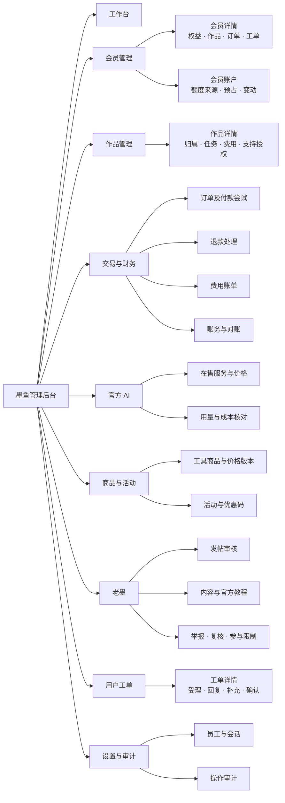

# 墨鱼管理后台页面地图

> 版本：v0.2｜日期：2026-11-09｜状态：设计候选
>
> 上游：[上市发布 PRD](commercial-launch-prd.md) · [后台设计 Brief](admin-design-brief.md) · [作者端设计建议](author-commercial-design.md)

## 1. 路径与范围说明

墨鱼是现有 c-foundry 作者端。本图仅规划其管理后台及跨端配合；作者端继续在当前产品内增量扩展。

`/admin/*` 是后台导航的逻辑路径候选。若后续采用独立域名或前端应用，可映射到该应用根路径，不在本轮定部署方式。表内路径均未成为生产路由，不修改当前[权威路由表](https://github.com/hrxmtc/c-foundry/blob/main/docs/reference/information-architecture-and-routes.md)；实施时必须同步真实路由和权限规则。

“首轮”表示本轮评审必须覆盖的核心页面，可分批制作；“后续”表示更深入的管理界面。按用户补充，会员、订单、作品、费用账单、会员账户、发帖审核和用户工单均进入首轮，不再仅验证资金售后。两者不改变 PRD 正式首发的 P0 定义。

## 2. 导航地图

菜单按角色展示，但真实授权在服务端逐操作校验。详情必须可通过有权限的直接链接到达；无权限时解释并提供返回点，不能仅靠不显示菜单保护。

## 3. 完整页面清单

| 编号   | 页面／候选路径                                                             | 使用者与核心任务                 | 首要内容或操作                                                               | 原型批次／PRD 对应                   |
| ------ | -------------------------------------------------------------------------- | -------------------------------- | ---------------------------------------------------------------------------- | ------------------------------------ |
| ADM-00 | 后台登录 `/admin/login`                                                    | 获授权员工进入运营空间           | 员工身份、登录失效、无后台权限与找回访问说明                                 | 首轮状态／§9.1                       |
| ADM-01 | 工作台 `/admin`                                                            | 各角色处理待办                   | 付款／退款／用量待核对、待审帖、待处理工单                                   | 首轮／AD-01                          |
| ADM-02 | 会员列表 `/admin/users`                                                    | 定位全部注册作者，不限付费者     | 标识、脱敏账号、免费／试用／付费权益及账号状态                               | 首轮／AD-02                          |
| ADM-03 | 会员详情 `/admin/users/:userId`                                            | 查询账号、权益和相关业务         | 账户、作品索引、订单、账单、AI 动作、帖子与工单                              | 首轮／AD-02、AD-09–12                |
| ADM-04 | 订单列表 `/admin/orders`                                                   | 定位已付款待到账、重复付款等问题 | 订单号、用户、商品快照、付款／履约／退款分别筛选                             | 首轮／AD-05                          |
| ADM-05 | 订单详情 `/admin/orders/:orderId`                                          | 查证付款并恢复未完成的履约       | 每次付款尝试、渠道查询、发放、退款与时间线                                   | 首轮／AD-05                          |
| ADM-06 | 退款列表 `/admin/refunds`                                                  | 财务处理申请和未知结果           | 申请、待审核、执行中、结果未知、待恢复分类                                   | 首轮／AD-05                          |
| ADM-07 | 退款详情 `/admin/refunds/:refundId`                                        | 确认可退范围并执行和核对         | 原付款、可退计算、预留、审批、原路退款与冲正                                 | 首轮／AD-05、AD-06                   |
| ADM-08 | 账务记录 `/admin/ledger`                                                   | 财务追溯变动                     | 收款、消费、赠额、退款、调整与关联原记录                                     | 首轮明细，后续全局工具／AD-06        |
| ADM-09 | 对账 `/admin/reconciliation`                                               | 财务处理渠道和业务差异           | 对账批次、差异明细、核查依据与处置结果                                       | 后续／AD-06                          |
| ADM-10 | 官方 AI 服务 `/admin/ai/services`                                          | 负责人维护在售官方服务           | 模型与计量项、价格版本、状态和停用影响                                       | 后续／AD-04                          |
| ADM-11 | AI 用量与成本 `/admin/ai/usage`                                            | 按职责核查消费和成本             | 作者结算、上游成本、未知项、平台承担                                         | 首轮账单关联，后续汇总／AD-04、AD-06 |
| ADM-12 | AI 动作详情 `/admin/ai/actions/:actionId`                                  | 处理一笔费用异议                 | 来源、授权、子调用、结算／预占／调整与问题记录                               | 首轮复用详情／AD-04、AD-09           |
| ADM-13 | 会员商品 `/admin/products`、详情 `/admin/products/:productId`              | 运营起草、负责人审核与发布       | 工具权益、期限、价格版本、已售影响                                           | 首轮权益视图，后续编辑／AD-03        |
| ADM-14 | 活动与优惠 `/admin/activities`、详情 `/admin/activities/:activityId`       | 运营维护简单促销                 | 资格、时段、名额、预算、核销与停用                                           | 后续／AD-07                          |
| ADM-15 | 老墨内容 `/admin/laomo/content`                                            | 管理公开内容和教程               | 分类、公开版本、隐藏／恢复、理由与审核记录                                   | 首轮关联状态，后续完整页／AD-08      |
| ADM-16 | 举报与复核 `/admin/laomo/reports`、详情 `/admin/laomo/reports/:reportId`   | 内容管理处理举报及处置复核       | 举报对象、依据、处置、作者可见说明与复核记录                                 | 后续／AD-08                          |
| ADM-17 | 社区参与 `/admin/laomo/members`                                            | 内容管理维护邀请与互动限制       | 参与权限、禁言范围／期限与恢复                                               | 后续／AD-08                          |
| ADM-18 | 用户工单 `/admin/tickets`、详情 `/admin/tickets/:ticketId`                 | 受理、分派和解决私密问题         | 回复、内部备注、补充、交接、确认和继续反馈；关联会员／作品／订单／动作／审核 | 首轮列表与详情／AD-09                |
| ADM-19 | 员工与会话 `/admin/staff`                                                  | 负责人授权和撤权                 | 固定职责、有效会话与撤销结果                                                 | 后续／§9.1                           |
| ADM-20 | 操作审计 `/admin/audit`                                                    | 各角色按权限追溯处置             | 人、对象、时间、理由、结果与关联请求                                         | 首轮业务内时间线，后续全局页／AD-09  |
| ADM-21 | 会员账户 `/admin/accounts`、详情 `/admin/accounts/:userId`                 | 客服查询、财务核对服务额度       | 购买／赠额／补偿、可用、预占、退款预留、到期及变动来源                       | 首轮／AD-11                          |
| ADM-22 | 作品列表 `/admin/projects`                                                 | 客服、负责人按必要范围定位作品   | 作品标识、归属、标题、管理状态、任务／工单关联                               | 首轮／AD-10                          |
| ADM-23 | 作品详情 `/admin/projects/:projectId`                                      | 定位作品服务故障和费用           | 管理信息、必要统计、任务、费用、工单和有效材料授权                           | 首轮／AD-10                          |
| ADM-24 | 费用账单 `/admin/bills`、会员账期视图 `/admin/bills/:userId`               | 财务、客服按职责核对             | 账期／作品／动作消费、期初期末、调整与明细，关联账户和订单                   | 首轮／AD-12                          |
| ADM-25 | 发帖审核 `/admin/laomo/reviews`、详情 `/admin/laomo/reviews/:submissionId` | 内容管理员审核明确版本           | 送审、通过／退回理由、撤回、重提、公开版候选对照及复核                       | 首轮／AD-13                          |

首轮不额外建设通用审批中心：退款审批在退款详情，补偿申请在相应作者／动作详情，商品审核在商品详情。用户工单形成完整服务流程；退款审批、费用更正和商品发布仍在各自业务详情中执行。

## 4. 首轮页面结构

### ADM-01：工作台

默认先显示“需要处理”，待办按问题类型、等待时长及负责职责筛选，点击直接进入订单、退款或动作。每项显示业务标识、问题、最后核对时间和下一步，不展示稿件正文。

收款、退款、已结算 AI 消费和上游成本分别展示，并标示统计时间范围及未知数量。充值收款不称为已实现利润，不通过合并成一个“收入”大数字掩盖口径差异。暂无待办时显示已核对范围，不把数据加载失败显示为一切正常。

### ADM-02／03：会员列表与详情

列表：昵称、用户标识、脱敏账号、账号状态、免费／试用／付费工具权益、官方额度摘要、待处理工单。默认不把作者作品数量、生成字数或消费额排成经营价值排名。

详情：页头固定作者身份和返回列表；主区按以下信息页签组织。

| 页签     | 内容                                           | 操作边界                             |
| -------- | ---------------------------------------------- | ------------------------------------ |
| 概览     | 账户及服务状态、待处理事项、常用关联对象       | 引导进入证据对象，不提供“修改余额”   |
| 工具权益 | 来源、起止时间、续期、撤销与历史               | 补发关联原订单；补偿另走申请         |
| 官方额度 | 购买／赠额／补偿、有效期、可用／预占／退款预留 | 逐来源可解释，不能只改合计           |
| 订单     | 付款、到账、退款摘要                           | 链接完整订单，不复制维护状态         |
| AI 动作  | 本人动作类型、来源、时间、消费和待核对         | 进入 ADM-12，不读取正文或 Key        |
| 支持记录 | 问题、进度、关联对象与可见答复                 | 允许交接，审批／资金执行返回对应对象 |

会员详情增加作品索引与工单关联页签，进入 ADM-23 或 ADM-18，避免重复维护数据。社区限制与账户安全限制分别展示；作品索引不附带正文阅读权，内容管理员不因审核帖子获得私有作品访问权。

### ADM-04／05：订单列表与详情

列表保留三个独立维度：付款、履约、退款，避免一个“成功”徽标掩盖已收款未到账。订单详情从上到下为：业务身份与金额快照、当前待办、付款尝试、履约与权益、退款、支持与审计时间线。

| 当前证据                 | 建议首选操作         | 不能出现的操作                     |
| ------------------------ | -------------------- | ---------------------------------- |
| 付款未知                 | 查询付款结果         | 手动标记已付款、凭截图发放         |
| 已验证付款、尚未履约     | 重试未完成发放       | 任意填写发放金额或再次售卖         |
| 已履约                   | 查看发放依据         | 再发一次同一订单权益               |
| 多次真实成功付款         | 处理多收退款         | 忽略额外付款尝试                   |
| 优惠订单迟付且名额已释放 | 复核资格、名额与预算 | 无条件补发、加价或夺回其他订单优惠 |
| 某笔退款结果未知         | 查询该笔退款         | 再建一笔替代退款猜测结果           |

### ADM-06／07：退款列表与详情

退款详情同时显示“钱的结果”和“权益／额度处理结果”。页面结构为：关联作者与原付款、申请原因、可退依据、已消费和赠额边界、相关预留、审核意见、执行与查询、权益冲正、作者可见结论。

未定案的可退规则显示依赖，不能用原型默认值伪装正式退款比例。审批通过只表明允许执行；渠道受理只表明正在处理；渠道成功后还需显示相关权益处理是否完成。

### ADM-12：动作费用详情

AI 动作详情从作者详情进入，并能关联支持事项。展示任务名称、AI 来源、动作授权上限、子调用状态、计量证据、作者结算、释放预占、平台成本与调整。BYOK 只有估算及配置归属，不显示为墨鱼正式扣费。

费用处理可以形成“不需调整／待核对／已更正／补偿申请”的有理由结论；实际金额更正或补偿需相应权限。作者可见答复与内部备注明确区分，内部服务商信息、私有调试材料不能自动出现在作者答复中。

### ADM-21／24：会员账户与费用账单

会员账户回答可用额度从哪里来、何时到期、哪些金额正在任务预占或退款预留；费用账单回答某账期为哪些服务消费了多少。二者与订单、账务明细交叉定位，数据使用统一依据。账期汇总包含期初、入账、消费、退款／调整、期末及待核对项；预占不重复记消费，BYOK 估算和平台成本单列。

客服可查证并提交更正／补偿申请，财务按权限执行。账单导出应标明范围和统计截止时间；汇总页面不是独立可修改的余额来源，也不冒充正式发票。

### ADM-22／23：作品管理

列表支持作品标识、归属账号与标题检索，按管理状态和服务问题筛选。详情展示必要管理信息、统计、相关任务、费用和工单；统计的字段来源在实施前核实，不当作质量评分或平台公开上架状态。

正文、设定、私有草稿与整本导出不作为默认内容页签。工单授权片段单独展示用途、版本、可访问职责、有效范围与状态；过期或撤销后拒绝后续访问。管理操作不能默认改写作者正文、解冻、删除或转移归属。

### ADM-25：发帖审核

待审列表显示帖子、作者社区身份、送审版本、时间与处理状态。详情显示本次送审内容、理由历史、已有公开版及候选差异，首要操作为“通过并公开”或“退回修改”，退回需要作者可见理由。先审策略是建议，按 PRD D07 定案后实现。

审核前重验版本、参与权限和撤回状态；已被他人处理时刷新结果，不覆盖同事的处置。修改公开帖不直接覆盖旧公开版；管理员隐藏、作者撤回与审核结果分开显示。被退回后重新提交产生新的审核对象和记录，不抹去旧理由。

### ADM-18：用户工单

列表按类型、状态、负责人、更新时间、会员和关联对象筛选。详情分为作者可见回复流、内部备注／交接、关联业务及授权材料；两种回复区有明确标识，避免误发内部信息。

状态建议为待受理、处理中、待作者补充、已答复待确认、已解决、已关闭。支持分派、交接、补充、作者确认及继续反馈；重开和时效由 D10 定案。工单不能直接把付款／退款改成成功，也不能无授权打开作品。列表与详情的加载、提交未知、并发回复和撤权均有恢复路径。

## 5. 作者端对照页面

以下都是现有墨鱼作者端的增量设计输入。路径引用 PRD 候选，不代表当前路由已启用。

| 作者端表面                                    | 后台对应               | 必须一致的内容                                 |
| --------------------------------------------- | ---------------------- | ---------------------------------------------- |
| 作者中心 `/account`、会员与续费 `/membership` | ADM-03、ADM-13、ADM-21 | 账号、权益、到期与账户摘要                     |
| 我的作品 `/projects` 的费用／支持入口         | ADM-22–23              | 同一作品、任务、费用和工单；材料授权范围与状态 |
| 我的订单 `/orders`、详情与收银台              | ADM-05                 | 商品快照、收款、履约、退款和相关工单           |
| 费用账单 `/billing` 的账户／消费／账期        | ADM-12、ADM-21、ADM-24 | 来源、预占、消费、待核对及调整                 |
| 订单内退款申请与进度                          | ADM-07                 | 可退范围、预留、渠道结果和权益变化             |
| 老墨与我的帖子 `/laomo/mine`                  | ADM-15–17、ADM-25      | 权限、送审版本、审核结果、公开版及处置复核     |
| 我的工单 `/support` 及详情                    | ADM-18                 | 回复、待补充、确认与继续反馈；内部备注不可见   |
| 活动 `/activities`                            | ADM-14                 | 资格、有效期、名额及优惠结果                   |

详细作者端页面与入口布局见[作者端设计建议](author-commercial-design.md)。

跨端使用同一业务标识和规则版本；后台不能通过“查看作者页面”默认冒用作者会话。模拟作者所见仅用于原型对照，不作为生产代登录能力立项。

## 6. 首轮原型完成定义

1. 会员、会员账户、作品、订单、费用账单、发帖审核和用户工单均有可进入的核心列表／详情与跨端对应，不能只停留在菜单名。
2. F01–F05 可走完；保留原列表筛选和返回点，按角色显示操作。
3. 可切换付款／退款未知、已付款未到账、费用待核对、审核退回／重提／撤回、待作者补充和材料授权失效等状态。
4. 审核页面可区分送审版本和已公开版本；工单能区分内部备注与对外回复；作品索引不默认展开私有正文。
5. 会员账户与账单能关联原订单和明细；账期、可用、预占和退款预留口径可解释。
6. 深色及三套浅色主题、1024px 与宽桌面及键盘操作可用；失败、部分完成、并发、撤权和会话失效都有恢复。

原型完成只证明交互可走查；资金正确性、归属隔离、权限即时失效、审核并发和真实渠道结果须在后续实现阶段分别验证。
