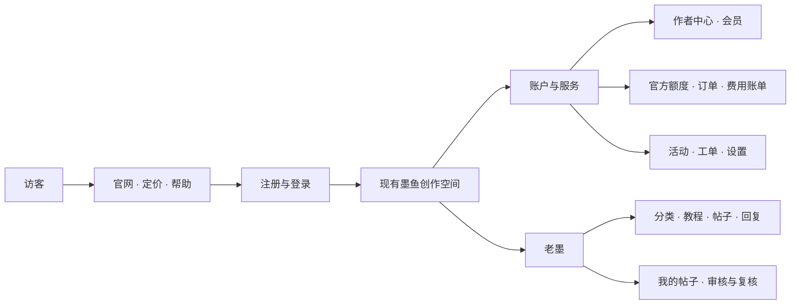

# 墨鱼作者端上市 PRD

> 文档版本：v0.1｜日期：2026-11-11｜状态：**完整评审稿，待 Vector 评审**
>
> 产品：墨鱼，即当前 c-foundry 作者端。本文规定作者端上市所需的功能和验收，不新建另一套作者产品。
>
> 上游：[上市总 PRD](commercial-launch-prd.md)。商品、计费、支付、退款、社区和支持授权的共同业务规则及 D01–D10 决策以总 PRD 为准；本文细化作者端要求。页面布局参考[作者端设计建议](author-commercial-design.md)，后台配合见[后台页面地图](admin-page-map.md)，跨端任务见[业务流程](commercial-cross-app-flows.md)。

## 0. 评审摘要

本稿把会话列出的 15 个作者端功能模块整理为可供产品、设计和后续 OpenSpec 使用的需求。文档中的“必须”表示本方案获批后的验收要求，不表示能力已经上线，也不代替商业规则裁决。

**已确认的方向：**

1. 墨鱼就是现有作者端，沿用创作空间，并补齐上市服务。
2. 同时支持作者自备 API Key 和墨鱼官方 AI。
3. 商业活动服务于墨鱼自身的会员、额度、优惠与推广。
4. 老墨用于使用技巧、创作心得和问题交流。
5. 后台覆盖会员、会员账户、作品、订单、费用账单、发帖审核和用户工单；作者端具备对应的查询、申请、处理进度与反馈入口。

**仍待评审的规则：**工具会员与官方用量分开核算的具体方案、价格与试用、支付市场与渠道、退款和赠额、老墨参与及审核策略、支持材料授权与工单服务时效。本文采用总 PRD 的建议设计，不擅自填写正式金额、期限或响应承诺。

建议先评审 §3 范围、§4 信息架构、§5 功能要求和 §11 决策依赖。

## 1. 背景、目标与成功判断

当前墨鱼的主任务是让作者管理创意、设定、规划、正文和审阅。上市需要补齐“了解产品 → 开始创作 → 选择服务 → 购买 → 看懂费用 → 获得帮助”的服务过程，同时保护已有写作体验。

| 目标                 | 可观察的结果                                               |
| -------------------- | ---------------------------------------------------------- |
| 新作者能独立开始     | 能说明两种 AI 来源的费用归属，并完成一个自己认可的创作任务 |
| 购买结果明确         | 能区分工具会员与官方额度；付款、到账、退款各有可查记录     |
| 费用可解释           | 能定位某次动作的来源、授权上限、消费和待核对项             |
| 问题可解决           | 能从作品或交易发起私密工单，查看答复并确认或继续反馈       |
| 老墨有帮助           | 能找到教程、完成发帖与审核流程，并获得可使用的回应         |
| 写作不被商业流程误伤 | 会员到期、额度不足或社区限制不阻止旧稿读、编、存、导       |

人数、转化率、毛利和响应时效没有已验证数值基线，不在本稿虚构目标；邀请验证前由负责人确定观察口径。注册、AI 出字、充值金额或发帖数量不能单独证明产品或作品价值。

## 2. 使用者与现有能力

| 使用者        | 主要任务                           | 关键设计要求                         |
| ------------- | ---------------------------------- | ------------------------------------ |
| 访客／新作者  | 了解能力和费用、注册、开始一次创作 | 真实说明、意图保留、入门路径清楚     |
| 自备 Key 作者 | 管自己的模型配置并创作             | 费用由服务商收取，估算与墨鱼账单分开 |
| 官方 AI 作者  | 选择服务、授权费用、使用额度       | 价格、上限、预占、结算和异常可解释   |
| 付费作者      | 续期、充值、查订单与账单、售后     | 历史规则可追溯，不因改价重算         |
| 老墨参与者    | 学技巧、发帖、回复、查看审核       | 参与条件、公开版本、理由和复核清楚   |
| 求助作者      | 提交问题和必要材料、跟踪解决       | 私密、少填重复信息、授权范围可控     |

创作能力的现状参照[现有功能真相](https://github.com/hrxmtc/c-foundry/blob/main/docs/design/current-features.md)及对应已完成规格；历史静态核对的版本和范围见[证据记录](commercial-launch-evidence.md)。本文不重新认定所有部署状态，也不把 FINAL 目标或历史商业原型当作已交付事实。

## 3. 范围与优先级

“P0”表示本方案建议的正式首发要求；邀请验证可以先使用其中的闭环子集，但不能据此宣称全部正式首发能力齐备。

| 编号  | 功能模块           | 本轮处理                         | 范围 |
| ----- | ------------------ | -------------------------------- | ---- |
| AP-01 | 产品介绍与帮助     | 新增／完善公开页面               | P0   |
| AP-02 | 账号与设置         | 沿用基础，补新流程衔接           | P0   |
| AP-03 | 作者中心           | 新增服务概览与入口               | P0   |
| AP-04 | 作品与创作         | 沿用创作，增加费用／支持入口     | P0   |
| AP-05 | 会员与续费         | 新增工具权益服务                 | P0   |
| AP-06 | AI 来源与使用      | 保留自备 Key，增加官方服务与授权 | P0   |
| AP-07 | 会员账户／官方额度 | 新增来源、可用和预留查询         | P0   |
| AP-08 | 我的订单与支付     | 新增购买、查单与到账查询         | P0   |
| AP-09 | 退款与票据         | 新增售后申请和进度               | P0   |
| AP-10 | 费用账单           | 新增正式消费、账期与异议         | P0   |
| AP-11 | 商业活动           | 新增简单优惠码与活动             | P0   |
| AP-12 | 老墨交流           | 新增最小交流社区                 | P0   |
| AP-13 | 我的帖子与审核     | 新增提审、重提及版本管理         | P0   |
| AP-14 | 我的工单           | 新增私密支持与反馈               | P0   |
| AP-15 | 站内提醒           | 新增相关业务提醒与定位           | P0   |

**P1：**邀请奖励、年付、自动续费、复杂升降级、多支付渠道、自动开票，以及关注、私信、即时聊天和个性化推荐。首版任意附件上传需另评估，不能从工单材料授权推导为已纳入。

本轮不承诺团队协作、版权交易、约稿市场、用户余额转账或提现、公开作品连载平台、无人审校跨单元整本生产。创作正文的发布／冻结也不转换为公共上架。

## 4. 信息架构与页面

作者使用三个主要区域：**创作空间、账户与服务、老墨**。访客另有官网、定价、帮助和服务说明。登录后的稳定落点保留我的作品，作者中心不重复建设写作统计首页。

15 个模块可共享页面和业务详情，不要求建设 15 个一级菜单。商业入口集中在账户区域；老墨、帮助在非专注创作页面稳定可达。写作中的费用与求助从相关任务进入，不用商业弹窗打断手工保存。

| 页面／表面             | 路径候选或承接方式                                  | 对应模块     |
| ---------------------- | --------------------------------------------------- | ------------ |
| 官网、定价、帮助及说明 | `/home`、`/pricing`、`/help`、`/terms`、`/privacy`  | AP-01        |
| 登录与设置             | 沿用 `/login`、`/settings`                          | AP-02、AP-06 |
| 作者中心               | `/account`                                          | AP-03        |
| 我的作品与工作台       | 沿用 `/projects`、`/workspace` 及现有创作页面       | AP-04        |
| 会员与续费             | `/membership`                                       | AP-05        |
| 费用账单               | `/billing`：额度账户／消费明细／账期汇总            | AP-07、AP-10 |
| 我的订单、详情与收银台 | `/orders`、`/orders/:orderId`、`/checkout/:orderId` | AP-08、AP-09 |
| 商业活动               | `/activities`                                       | AP-11        |
| 老墨与帖子详情         | `/laomo`、`/laomo/posts/:postId`                    | AP-12        |
| 我的帖子与编辑         | `/laomo/mine`、`/laomo/editor/:postId`，含新建入口  | AP-13        |
| 我的工单与详情         | `/support`、`/support/tickets/:ticketId`            | AP-14        |
| 站内提醒               | 非专注页面入口及业务内提醒视图，位置由原型验证      | AP-15        |

新路径均为候选，未成为生产路由。实施时与[权威路由表](https://github.com/hrxmtc/c-foundry/blob/main/docs/reference/information-architecture-and-routes.md)、认证和对象归属规则同步；公开定价可供已登录或未登录作者访问，不能被登录后默认跳转覆盖。

## 5. 功能要求

### AP-01 产品介绍与帮助

**用户目标：**在注册或购买前知道墨鱼能做什么、费用由谁收取、遇到问题如何处理。

- 展示真实已交付能力、适用任务、两种 AI 来源、工具权益和官方用量的关系，以及注册、登录和定价入口。
- 定价说明包含权益、期限、适用范围、前置条件、未包含项目及售后规则；未确定金额显示待确认，不能采用历史设计的示例价格。
- 帮助覆盖入门、两种 AI 配置、付款未到账、用量待核对、退款、社区参与及工单；官方教程显示更新时间。
- 服务和隐私说明可在购买、发帖和材料授权等相关位置查阅。演示材料和真实功能、测试数据和正式承诺明确区分。

**异常与验收：**说明页加载失败可重试；购买前后可重新找到适用条款。未登录的购买意图在登录后恢复到原商品，由作者最终确认新订单，不自动扣款。

### AP-02 账号与设置

**用户目标：**进入自己的创作空间，管理模型、外观和账户安全。

- 复用现有注册、登录、密码及会话管理；设置继续承接 LLM 配置、写作目标和四主题，不另建重复安全页面。
- 登录失效后保留安全的返回意图；新账号完成必要的 AI 来源选择或继续手工创作，不强制先付费。
- 作者只能查本人订单、消费、工单、草稿和授权材料；复制网址、换设备或多标签访问不扩大权限。
- 账号安全、工具会员、官方额度和社区参与分别表达；作者身份不附带员工后台权限。

**异常与验收：**未登录先认证，登录后再校验对象归属；其他账号访问同一对象被拒绝。登录、主题或 AI 默认配置变化不丢失已有创作内容。

### AP-03 作者中心

**用户目标：**一屏了解自己能用什么服务、哪些事情需要处理，并快速返回写作。

- 分开呈现工具会员、AI 来源、官方额度和待处理事项，展示数据时间与可查询入口。
- 会员区显示权益和准确期限，额度区显示可用与处理中金额摘要；服务来源可进入设置或服务说明。
- 待办包括待支付／待到账订单、退款需关注状态、待作者补充的工单和相关提醒；点击进入原对象。
- 提供会员、账单、订单、活动、工单、设置和继续创作入口；创作统计仍由既有作品和仪表盘负责。

**异常与验收：**某区域查询失败不把金额显示为零，不遮蔽其他可用区域。首次无交易与有交易但查询失败分别呈现；从待办进入、返回后可保留位置。

### AP-04 作品与创作

**用户目标：**继续使用熟悉的创意、设定、规划、写作、审阅、版本与导出能力，并能就某本作品查费用或求助。

- 复用现有作品、创意、剧本与写作空间，不因商业化新增平行生成器、自动采用或自动公开作品。
- 作品上下文增加“查看本书费用”“反馈问题”；相关费用或任务无作品归属时如实说明，不猜测作品。
- 反馈默认只关联定位所需元数据。私有正文、提示词、Key、设定和草稿不随问题自动上传。
- 如需正文支持，作者选择明确片段／版本并预览用途、可查看职责和有效范围后授权；可查看并撤销后续访问。新写入内容不自动加入旧授权。
- 会员到期或官方额度不足，已有稿件仍可阅读、手工编辑、保存和导出；社区禁言和工单状态不误伤创作。

**异常与验收：**支持材料过期或撤销后，后台不能继续读取；客服可继续使用获准的元数据定位问题。授权失败不被当成已授权，返回创作不清空输入或切错作品。留存与清理由 D09 定案。

### AP-05 会员与续费

**用户目标：**理解工具权益，购买或延长服务，知道到期后会发生什么。

- 展示当前工具权益、试用／付费状态、准确起止时间、可购买方案和限制；具体权益、试用和价格由 D03 确认。
- 工具会员与官方额度分别解释、分别选择；套餐若附赠额度，明确赠额来源、期限和适用范围。
- 首版建议手动购买、手动续期；有效期内续期接原到期点，已到期从新权益生效点起算，服务月和时区按总 PRD。
- 工具会员将到期而仍有官方额度时，提前解释使用条件及符合政策的处理路径，不隐藏额外会员前置要求。

**异常与验收：**付款成功但未发权益保持待到账；重复通知不延长两次。到期不删除旧稿或已有版本，已取得有效费用授权的任务按既定范围完成。

### AP-06 AI 来源与使用

**用户目标：**明确使用谁的 AI、由谁收费以及本次最多花多少。

- 保留自备 Key 配置；新增官方在售服务目录，显示可用模型／服务、有效价格、限制和当前状态。
- 自备 Key 的服务商估算费用与墨鱼正式消费分开；自备调用不得消耗官方额度。
- 一次动作启动时锁定来源、模型和计费规则，覆盖相关生成、检查、记入设定及授权范围内重试。运行中改默认来源只作用于后续动作。
- 官方动作执行前说明任务范围、预估和明确授权上限；按完整动作预占，子调用并发共享该总上限，新增超范围付费调用需追加授权。
- 结束后展示可保留结果、实际消费、失败步骤、待核对项和释放预占；可进入动作费用详情。

**异常与验收：**来源不可用不自动切换付费来源或更换价位。作者结算不超过既有授权，流式结束后超出的上游成本由平台承担，不能向后续充值追扣。平台／上游失败且无可用结果不收费；中止、部分完成及未知用量依总 PRD §6，不能以零费用假装核对完成。

### AP-07 会员账户／官方额度

**用户目标：**知道可消费多少、额度来源和为什么有一部分暂不可用。

- 在账单的额度账户视图展示购买额度、套餐／活动赠额、售后补偿及各自有效期、服务适用范围和变动。
- 区分可用、任务预占、退款预留、已结算和到期；不能把预占重复视为已消费，不能把不适用当前服务的额度算成可用。
- 充值／购买进入明确商品和收银台；来源详情能关联订单、发放或调整依据。
- 退款、撤回、补偿与费用更正形成可追溯记录，不直接改余额；本轮没有转账、提现能力。

**异常与验收：**并发任务与退款不能重复占用同一可用额度或产生负余额。余额查询失败显示未知并允许重查，不能渲染为零后催促充值；额度期限和售后规则依 D05。

### AP-08 我的订单与支付

**用户目标：**知道买了什么、付没付款、权益是否到账，以及如何恢复中断的购买。

- 订单列表与详情展示订单号、商品及规则快照、时间、原价、优惠、实付、币种、付款、履约、退款和关联工单。
- 收银台展示商品类型、期限／额度、前置条件、优惠、截止时间、支付方式和售后；优惠由服务端复核后本人确认。
- 付款与履约分开呈现；订单刷新、换设备后仍按归属查询原单。前端支付返回页不作为发放依据。
- 已付款未到账可查询和提交关联工单；已有订单可恢复，不要求作者通过再次付款证明旧单状态。

**异常与验收：**超时或回调丢失保持正在核对。一个订单多次真实成功付款只履约一次，额外收款逐笔原路全退并可查状态；不能把额外付款当重复通知忽略。关闭后的迟付按原规则查证，优惠已释放时须重新取得资格、名额和预算，否则按原实付全退，不补差价、不夺回他人优惠。

### AP-09 退款与票据

**用户目标：**提出售后申请并看懂资金和权益的处理结果。

- 从本人订单申请退款，查看适用条款、可申请范围、原因、受理状态和关联工单。已消费、赠额及工具期间的规则由 D05 定案。
- 受理时说明相关额度预留及影响范围，不冻结其他订单额度或私人稿件。
- 分别显示申请／审批、渠道执行、退款结果、权益或额度调整；已提交、已批准和资金已退不能混称已完成。
- 票据首版支持申请、补充必要资料、状态查询和联系路径；账单导出不冒充发票。是否自动开票留到 P1。

**异常与验收：**退款未知保留相关约束并查原退款；明确失败释放该次预留，再重试时重新核验可退范围。资金已退但权益冲正失败时保留恢复待办，只重试未完成部分，不能再次退钱或放开已退额度继续消费。票据请求失败保留输入且不重复受理。

### AP-10 费用账单

**用户目标：**知道在某段时间、某本作品和某次动作上实际消费了多少。

- 提供消费明细、动作费用详情和账期汇总；可按时间、作品、动作和 AI 来源筛选，返回列表保留筛选。
- 正式消费展示来源、服务、适用价格、授权上限、消费／待核对／调整状态，分项及 token 证据按需展开。
- 账期汇总按已入账记录说明期初、入账、消费、退款／调整和期末，未知项单列；任务预占与退款预留影响可用，不重复记入已结算消费。
- 订单、账户来源、消费和调整相互追溯；导出本人账单标明范围、币种与统计截止时间。
- 从某次消费提出费用异议，自动关联该动作，作者预览必要上下文后提交私密工单；说明结论或更正可从原动作查看。

**异常与验收：**BYOK 估算、平台上游成本和作者正式消费不混合求和。未知用量不填零；费用更正保留原记录并关联调整，不能用赠额掩盖错误账项。服务额度退回不显示为现金原路退款。

### AP-11 商业活动

**用户目标：**知道有哪些可参加的优惠、为何可用或不可用，以及最终优惠结果。

- 活动页展示适用对象、商品、起止时间、领取／使用条件、次数、名额和规则；本人可查领取及使用记录。
- 首版建议指定商品固定金额优惠码，每单最多一个，最终实付在渠道支持范围内；活动规则由 D06 确认。
- 使用前解释有效、过期、无资格、用尽或已使用等结果；失败保留商品选择，接受原价需本人明确确认。
- 修改或停用活动不重写已确认订单；优惠占用、释放、核销和退款按总 PRD，不默认退款后恢复资格。

**异常与验收：**支付未知时不因本地超时贸然释放名额；迟付和并发名额处理沿 AP-08，不超预算、不加价。邀请现金返佣等历史原型内容不作为首版活动承诺。

### AP-12 老墨交流

**用户目标：**学习使用技巧、交流创作心得并获得有上下文的帮助。

- 建议分类为墨鱼使用技巧、创作心得、问题求助；支持分类、时间排序、标题／正文搜索及官方／精选筛选。
- 作者可阅读教程与帖子，具备参与权限后发帖、回复或引用回复，修改／撤回本人内容；权限由服务端验证。
- 教程和官方身份明确标识，内容显示更新时间；社区身份不公开邮箱、支付姓名、账单和作品库。
- 支持举报、查看本人举报进度和处置说明，隐藏内容不通过搜索、引用、通知或回复上下文泄露。
- 分享作品片段由作者主动选择、预览并确认公开；私密工单和授权材料不自动变成公开求助或教程。

**异常与验收：**首次空态给出真实入门材料，筛选无结果与请求失败分别呈现。社区故障、禁言不影响保存、账单和工单。登录可读／邀请写及回复治理策略由 D07 确认，不能把付费会员自动当作社区发言许可。

### AP-13 我的帖子与审核

**用户目标：**查看自己发过什么、当前哪一版公开，以及审核后如何继续。

- 我的帖子显示草稿、送审、公开、退回、撤回及被隐藏等实际状态；草稿按账号隔离，提交前可预览并恢复草稿。
- 展示送审版本、提交时间、审核进度、决定、理由和复核入口；修改重提保留历史理由，不能覆盖审核依据。
- 审核模块为确认范围；本稿建议帖子先审后公开，回复是否先审单独由 D07 决定。新策略未定案不承诺审核时效。
- 已公开帖的修改作为新候选，公开版与候选分开；候选审核失败不覆盖仍有效的公开版。
- 作者可撤回；管理员隐藏或参与权限变化分别显示，复核可进入私密工单。

**异常与验收：**提交超时先查原提交；旧版本、撤回内容或无效参与权限不能被迟到审批误公开。未受邀账号不能通过隐藏入口以外的方式提交新帖或回复，已有私有草稿仍保留。公开、搜索、引用和提醒读取同一可见版本。

### AP-14 我的工单

**用户目标：**私密说明问题、补充资料，并跟踪到有依据的处理结论。

- 支持会员权益、订单支付、费用异议、作品／AI 故障、社区复核和其他建议；可从工单页或相应业务对象创建。
- 表单包含类型、描述和本人关联对象；默认元数据先行，正文等材料仅按 AP-04 明确授权，不上传完整 Key。
- 详情展示作者可见对话、处理状态、关联对象、授权范围与结论；支持补充、查看答复、确认解决或继续反馈。
- 建议流程为待受理 → 处理中 ↔ 待作者补充 → 已答复待确认 → 已解决 → 已关闭；关闭后重开、响应时效及留存由 D10 确认。
- 后台内部备注、分派和技术敏感信息不进入作者回复；工单中“已答复”不代表已退款或已公开帖子。

**异常与验收：**提交或回复超时先查询原提交，输入不丢失；转派不自动扩大材料访问。未解决可继续反馈，不冒充作者已确认；会员到期或社区禁言后仍可访问本人工单。首版任意附件上传不随文本和受控材料授权自动纳入。

### AP-15 站内提醒

**用户目标：**知道需要关注的变化，并进入正确业务继续处理。

- 覆盖回复、官方答复、审核决定、社区处置、工单答复，以及需要关注的到账／退款变化；内容来自真实业务事件。
- 提醒可定位本人有权访问的帖子、版本、订单、退款或工单；显示事件时间、业务状态及已读／未读。
- 重复事件不重复制造同一业务提醒；“收到通知”不等于业务成功，进入详情需重新查询真实状态。
- 仅纳入站内提醒，不默认新增短信、邮件群发、私信或即时聊天。

**异常与验收：**对象被隐藏、撤回、授权失效或权限变化后，提醒不泄露原文，能说明当前不可见原因和返回点。提醒故障不阻塞业务查询和写作。

## 6. 关键任务与后台配合

| 流程         | 作者端主路径                                                    | 后台对应                   | 必须体现的异常                             |
| ------------ | --------------------------------------------------------------- | -------------------------- | ------------------------------------------ |
| 新作者开始   | 了解产品 → 注册／登录 → 选择 AI 来源或手写 → 完成一次认可的任务 | 会员与官方服务管理         | 未配置、无权益、无额度时解释且保留手工创作 |
| F01 购买到账 | 选商品 → 确认订单 → 支付 → 查询到账 → 回创作                    | AD-02、AD-03、AD-05、AD-11 | 付款未知、未到账、多收款、优惠迟付         |
| F02 费用异议 | 动作费用 → 提工单 → 查结论／更正 → 继续写作                     | AD-04、AD-09、AD-12        | BYOK 误解、超授权、未知用量、部分完成      |
| F03 退款     | 原订单申请 → 预留与处理 → 查资金和权益结果                      | AD-05、AD-06、AD-09、AD-11 | 并发消费、结果未知、冲正失败               |
| F04 发帖审核 | 编辑预览 → 提审 → 理由／结果 → 重提或公开                       | AD-08、AD-13               | 撤回、旧审批、公开版修改、参与撤权         |
| F05 私密工单 | 关联对象 → 提问／授权 → 回复补充 → 确认或继续反馈               | AD-09、AD-10及关联业务     | 交接、材料撤销、提交未知、内部备注隔离     |

后台七项配合：会员负责身份与权益，会员账户负责来源和可用额度，作品负责运营索引与支持关联，订单负责支付履约，费用账单负责消费核对，发帖审核负责版本公开，工单负责问题跟踪。它们不是作者端各自再维护一份状态的理由。

## 7. 共用状态与交互要求

| 状态           | 作者应看到什么                                     | 恢复路径                                     |
| -------------- | -------------------------------------------------- | -------------------------------------------- |
| 首次无数据     | 本区用途及适用的最短操作                           | 入门、选择服务、创建问题或返回写作           |
| 筛选无结果     | 保留筛选，不误称账号无记录                         | 调整／清除筛选                               |
| 加载           | 保留页面、对象身份和已知内容                       | 等待或返回；不闪现余额零、无订单             |
| 请求失败       | 哪个区域未取得新结果，保留输入                     | 重查该对象，不伪造失败或成功事实             |
| 结果未知       | 付款／退款／费用正在核对及相关影响                 | 查原操作、查看进度或关联工单                 |
| 部分完成       | 已保留结果与未完成部分分别列出                     | 使用已有结果，仅恢复未完成步骤               |
| 权限／权益不足 | 区分未登录、非本人、会员、额度、社区参与或授权失效 | 认证、返回、续费、充值或反馈，按实际原因提供 |
| 版本／并发冲突 | 说明对象已更新，保留本次输入                       | 查新状态后再决定，不覆盖他人或历史处理       |
| 完成           | 可核对的业务结果和准确返回点                       | 回原列表、详情或创作上下文                   |

沿用根 [DESIGN.md](../../DESIGN.md)：四主题、桌面优先、至少 1024px 基线、键盘可达、可见焦点、明确表单标签和语义状态色。金额显示币种、含义与状态；关键时间显示时区。业务错误与恢复入口保留在任务区，不能仅靠短暂 Toast。

自动保存不触发付费 AI；支付、社区和提醒的故障不通过整站只读处理。需要改变权限、资金、公开可见性或授权范围的动作，提交前明确对象及影响，成功后以真实结果更新。

## 8. 概念与数据关系

这是产品对象关系，不指定数据库表或技术框架。

| 对象           | 作者需要理解的关系                                           |
| -------------- | ------------------------------------------------------------ |
| 作者账号       | 拥有自己的作品、订单、消费、工单和私有草稿                   |
| 工具权益       | 来源于已履约购买或批准发放，具有时间与适用能力               |
| 服务额度       | 分购买／赠送／补偿来源，关联发放、预占、消费、退款或到期     |
| 订单与付款尝试 | 一单可有多次尝试，一单仅一次履约，额外真实收款有逐笔退款归属 |
| AI 动作与消费  | 固定来源、授权和价格，聚合子调用，保留结算和调整证据         |
| 账期汇总       | 来自已入账变动，能回到明细，不单独改出另一份余额             |
| 帖子与送审版本 | 私有候选、送审决定和公开版分离，公开受当前状态约束           |
| 工单与材料授权 | 关联本人业务；材料访问按明确版本、范围、职责和有效性控制     |
| 提醒           | 指向业务事件与对象，不能取代真实业务状态                     |

## 9. 验收清单

自动检查、原型走查和真实业务验证分别留证。原型可点击不证明账务、权限或并发正确；CI 通过也不代替真实作者理解与实际渠道验证。

| 编号  | 场景                                     | 通过标准                                                   | 对应模块                                 |
| ----- | ---------------------------------------- | ---------------------------------------------------------- | ---------------------------------------- |
| AA-01 | 访客了解费用并登录购买                   | 定价可公开读，登录后商品意图保留并本人确认                 | AP-01、AP-02                             |
| AA-02 | 新作者选择来源并返回写作                 | 来源与费用归属可解释，缺配置仍可手工创作                   | AP-03、AP-04、AP-06                      |
| AA-03 | 工具会员购买、续期、到期及运行中到期     | 权益与期限可查，不重复延长，不锁旧稿，已授权动作按范围完成 | AP-05                                    |
| AA-04 | BYOK 完成含子调用的创作动作              | 来源归属不变，不出现官方消费，估算单列                     | AP-06、AP-10                             |
| AA-05 | 官方 AI 并发、超授权及迟报用量           | 共享动作上限，不超作者既有授权；未知、释放和平台承担可核对 | AP-06、AP-07                             |
| AA-06 | 失败、中止、部分完成与未知用量           | 结果保留，收费／预占／恢复符合总 PRD §6，未知不作零        | AP-06、AP-10                             |
| AA-07 | 回调丢失／重复／乱序、同单多次成功收款   | 原单可恢复，仅一次履约，多收逐笔原路退款且有进度           | AP-08、AP-09                             |
| AA-08 | 优惠名额释放后的迟付和并发核销           | 满足资格／名额／预算才原价履约，否则原实付全退             | AP-08、AP-11                             |
| AA-09 | 退款期间消费、未知／失败及冲正暂失败     | 只约束相关额度，原退款可核对，资金与权益均有正确归属       | AP-07、AP-09                             |
| AA-10 | 订单、账户、消费、账期与调整互查         | 口径一致，预留不重复记消费，BYOK 和平台成本不混入账单      | AP-07、AP-08、AP-10                      |
| AA-11 | 账单导出和票据申请                       | 仅本人范围、统计截止清楚，申请进度可查，导出不称发票       | AP-09、AP-10                             |
| AA-12 | 社区读写权限、搜索、回复、举报           | 服务端权限与界面一致，隐藏材料不经引用／搜索泄露           | AP-12                                    |
| AA-13 | 退回重提、公开版修改、撤回与并发审核     | 版本和理由可辨，旧审批不误公开，候选失败不改有效公开版     | AP-13                                    |
| AA-14 | 工单提交超时、补充、转派、确认与继续反馈 | 原问题可恢复，输入保留，内部备注隔离，不虚报资金或作者确认 | AP-14                                    |
| AA-15 | 作品片段授权、更新、撤销和到期           | 无默认稿件访问，新版本不扩大授权，过期／撤销拒绝后续读     | AP-04、AP-14                             |
| AA-16 | 多账号访问订单、账单、工单、草稿和材料   | 认证后仍逐对象拒绝越权，不以隐藏按钮代替服务端保护         | AP-02、AP-04、AP-08、AP-10、AP-13、AP-14 |
| AA-17 | 回复／审核／工单／退款提醒及对象不可见   | 定位正确对象、重复事件去重，不泄露无权正文，不把通知当成功 | AP-15                                    |
| AA-18 | 四主题、键盘、1024px 及宽桌面            | 金额、状态、焦点和主要操作可辨，详情返回不丢筛选           | AP-01–AP-15                              |
| AA-19 | 支付、社区或提醒故障及会员到期／禁言     | 旧稿读编存导和本人账单、订单、工单仍可用                   | AP-02–AP-15                              |

验收前还需把 D01–D10 的适用裁决写入总 PRD，确认真实在售权益、模型、商户和支持人员。支付阶段使用渠道验证及负责人安排的真实小额购买／退款；本次生成 PRD 不执行资金或外部通知操作。

## 10. 推进与退出条件

| 阶段     | 作者端交付与配合                                  | 退出条件                                             |
| -------- | ------------------------------------------------- | ---------------------------------------------------- |
| 规则评审 | 本 PRD、总 PRD 决策、权益与服务说明               | 待决项有归属；影响售卖和材料访问的规则明确           |
| 原型走查 | 15 模块入口与七项后台能力对照，F01–F05 同对象演示 | 正常及未知／失败／退回／撤销路径可理解，问题有记录   |
| 商业基础 | 身份与权益、官方来源、额度、账务及相应后台        | 账务、授权、隔离和并发不变量有证据，不开放未验证售卖 |
| 邀请验证 | 作者中心、购买支付、账单售后、作品支持和工单      | 作者能独立完成创作与付费任务，小额购买退款验证通过   |
| 正式首发 | 活动、老墨、审核、内容与管理人手，加全部 P0       | 全部首发验收及服务说明齐备，负责人确认开放范围       |

商业化范围例外与 release-train、OpenSpec 衔接沿总 PRD D08；本文是产品评审材料，不单独改变 compass 范围、生产入口、数据库或创作生成策略。

## 11. 待定事项与决策来源

决策只在[总 PRD §15](commercial-launch-prd.md#15-待-vector-裁决的事项)维护。本表解释作者端受影响位置，不另建冲突的决策记录。

| 决策                               | 影响的作者体验                       |
| ---------------------------------- | ------------------------------------ |
| D01 邀请验证与正式首发范围         | 页面可见范围、上线说明及验收门       |
| D02 市场、币种、支付及票据         | 收银台、金额时间、售后与票据         |
| D03 工具权益、试用及价格           | 定价、会员、付费动作与到期提示       |
| D04 官方计价与消费确认             | 来源目录、预算、授权、费用详情       |
| D05 额度期限、退款、赠额及未知用量 | 账户、待核对、退款、预留与到期说明   |
| D06 优惠与邀请                     | 活动、优惠资格与订单                 |
| D07 老墨参与、审核及管理人手       | 发帖／回复权限、审核版本、理由与复核 |
| D08 上市准入与版本                 | 后续实施分期和对外版本声明           |
| D09 支持授权与留存                 | 作品反馈、共享片段、撤销／到期与清理 |
| D10 工单服务规则                   | 响应说明、状态、重开与附件范围       |

## 12. 文档状态与变更

| 日期       | 文档版本 | 内容                                                                              | 状态                                   |
| ---------- | -------- | --------------------------------------------------------------------------------- | -------------------------------------- |
| 2026-11-11 | v0.1     | 从已讨论的 15 模块生成独立作者端 PRD，补充页面、异常、后台对应和 AA-01–AA-19 验收 | 待产品评审，未作本版本独立评审通过声明 |

本稿根据会话、上市总 PRD 与配套设计整理，没有重新认定部署状态。后续若改变共同商业规则，先在总 PRD 记录裁决，再同步本文和设计稿；原型和实现偏离本稿时留变更依据。
