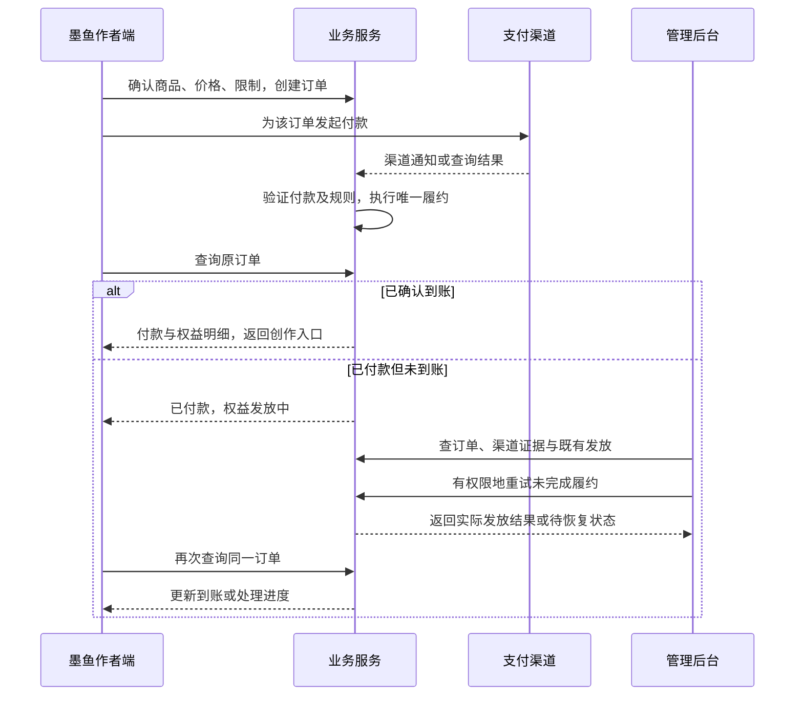
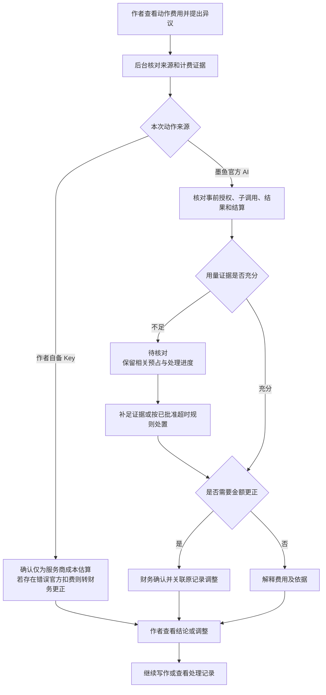
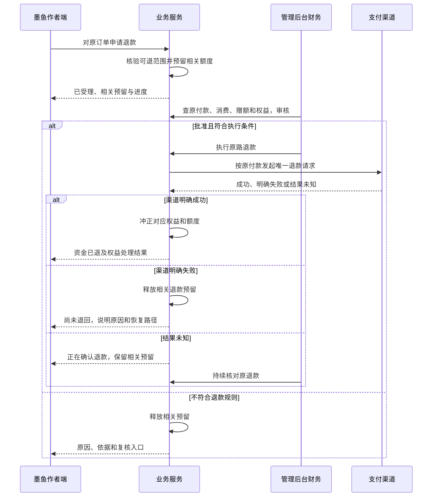
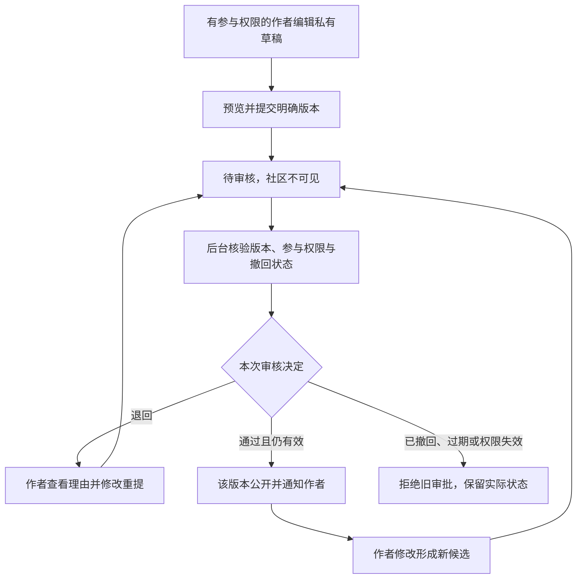

# 墨鱼作者端与管理后台：业务流程

> 版本：v0.2｜日期：2026-11-09｜状态：设计走查稿
>
> 依据：[上市发布 PRD](commercial-launch-prd.md)；页面见 [后台页面地图](admin-page-map.md)，权限见 [设计 Brief](admin-design-brief.md)。本文中的作者端就是现有墨鱼 c-foundry。

## 1. 共同约定

以下流程用于设计和原型走查，业务状态名称描述界面含义，不预先指定数据库枚举、表结构或接口。业务规则冲突时回到 PRD 裁决，不以原型按钮倒推产品承诺。

- 同一订单、付款尝试、履约、AI 动作、退款和用户工单有可关联标识；作者端仅访问本人对象，后台按职责访问必要信息。
- 支付、到账、AI 执行、费用结算、退款和权益冲正分别显示。前一步完成不自动证明后一步完成。
- 请求超时只表示本次没有拿到结果；先查询原操作，不能以重建交易或盲目重试来猜测结果。
- 后台动作记录操作者、对象、原因、结果与关联依据。作者看到自己的业务进度和可理解的说明，内部备注按可见性隔离。
- 离开详情、刷新或重新登录后从同一业务恢复。客户端筛选和草稿可恢复，资金与权益事实由服务端记录恢复。

## 2. F01：作者付款 → 权益到账 → 后台查证与补发

**目标**：作者买到已确认的商品；真实付款有履约或退款归属；运营可以处理未到账，不能重复发权益。

**入口**：现有墨鱼作者中心／定价 → 收银台；异常从本人订单或后台待到账列表进入。正常成功后回到作者中心，并保留返回原创作位置的入口。

| 步骤          | 作者看到／能做什么                                     | 后台看到／能做什么                     | 成功依据                           |
| ------------- | ------------------------------------------------------ | -------------------------------------- | ---------------------------------- |
| 1. 确认购买   | 商品、期限／额度、优惠、实付、限制及售后说明；本人确认 | 商品与规则版本，订单快照               | 服务端复核后的订单                 |
| 2. 完成付款   | 正在确认付款，保留订单号；可以查询或离开后恢复         | 每次付款尝试及渠道状态                 | 经核验的渠道收款结果，非前端返回页 |
| 3. 发放权益   | 已付款／发放中／已到账分开显示                         | 原付款、唯一履约、权益与额度记录       | 对应权益实际生效                   |
| 4. 查证未到账 | 从原订单提交问题，不要求再次付款                       | 查渠道、既有发放及失败原因；按权限重试 | 已付款且确有未完成履约             |
| 5. 完成处理   | 同一订单展示到账时间、期限／额度或退款结果             | 记录处置人、结果及关联变动             | 两端指向同一业务结果               |

**必须走查的分支：**

| 情况                       | 作者端状态与恢复                       | 后台处理边界                                                                 |
| -------------------------- | -------------------------------------- | ---------------------------------------------------------------------------- |
| 回调丢失、乱序或重复       | 查询原订单，不重复购买                 | 主动查单；发放不因重复通知重复执行                                           |
| 付款尚未知                 | 正在确认付款                           | 继续核对，不能标未付款、凭截图补发或无依据释放优惠名额                       |
| 一个订单多次付款都真实成功 | 每笔收款都可追溯，额外收款显示退款进度 | 选择唯一有效付款履约，其余逐笔全额原路退款；未知／失败进入待办               |
| 订单关闭后核实迟付         | 显示核对与到账／原路退款结果           | 符合原规则才补发；优惠名额已释放时必须重取资格、名额与预算，否则按原实付全退 |
| 补发超时、同事并发补发     | 发放中，查询原单                       | 重新查发放记录；服务端保证同一订单不重复履约                                 |
| 商品改价或下架             | 历史订单仍显示原快照                   | 不以现价重算已确认购买                                                       |

**完成标准**：一笔真实收款最终具有唯一的履约或退款归属；作者能从原订单恢复和解释结果。后台有持续待办时可完成交接，但不能把仍待核对的业务标为已解决。

## 3. F02：作者提出 AI 费用异议 → 后台核对 → 更正或说明

**目标**：费用来源、授权范围和结果可解释；收费错误可更正；平台成本、作者消费和 BYOK 估算互不混淆。

**入口**：墨鱼 `/billing` 的动作费用详情 → 提出异议。作者不需要提交正文或完整 Key；订单／动作标识随本人提交关联。后台从用户工单或作者详情进入 ADM-12，结束后返回原待办。

| 核对项     | 后台展示                                 | 作者可见的解释                                     |
| ---------- | ---------------------------------------- | -------------------------------------------------- |
| 来源锁定   | 动作启动时的来源和模型，所有子调用归属   | 本次用谁的服务，为什么产生这类费用                 |
| 授权       | 适用价格版本、动作范围和作者明确授权上限 | 当时确认了什么，最多可收多少                       |
| 执行与结果 | 子步骤成功／失败／中止，是否保留可用结果 | 哪些结果已交付，哪些没有完成                       |
| 计量       | 实际计量项、来源证据、未知项             | 费用分项，必要时展开 token 明细                    |
| 结算       | 预占、实际消费、释放及调整               | 已扣、处理中、已退回服务额度等分别说明             |
| 平台成本   | 上游成本、平台承担差额与未知成本         | 只显示与本人收费有关的结论，不泄露内部敏感调试信息 |

**必须走查的分支：**

| 情况                             | 处理规则                                 | 防误操作要求                                                     |
| -------------------------------- | ---------------------------------------- | ---------------------------------------------------------------- |
| BYOK 估算被作者理解为正式扣费    | 说明费用由其服务商收取；修正界面误解     | 不凭估算金额创建墨鱼扣款；若确有错误扣款，另行关联更正           |
| 实际上游费用超过动作授权         | 作者消费封顶，超额由平台承担，保留结果   | 不事后追扣、不以新充值填旧差额                                   |
| 平台／上游失败且无可用结果       | 不向作者收费，释放相关预占               | 不因上游向平台收费而向作者转收                                   |
| 作者中止、有可用部分且用量可核对 | 依事前规则结算已发生部分，不超授权       | 部分结果保留，补做需新的明确授权                                 |
| 用量未知                         | 保持待核对，展示相关预占与进度           | 不填零冒充核对完成；时限与超时处置依 D05，未裁决前不承诺 24 小时 |
| 确认多扣、重复扣费或误收费       | 财务关联原消费更正，保留前后记录         | 不删除原消费，不通过再送一笔赠额掩盖账差                         |
| 合理收费后提出善意补偿           | 区分账务更正与补偿申请，审批后按来源发放 | 不由客服随意改余额，不把额度补偿称为现金退款                     |
| 处理中撤销员工权限               | 表单保留业务身份并拒绝越权提交           | 转交有权限者，不能沿用旧按钮继续操作                             |

账务更正是否需要退回现金，需关联原购买额度与适用售后规则，不能把服务额度调整直接显示为原路退款。若涉及现金退款，转 F03，沿同一用户工单关联处理。

**完成标准**：作者能看懂来源、授权和最终费用；更正关联原消费、无重复调整。待核对、待审批和财务执行未结束时，问题保持处理中；确有解释或可核对的调整后才形成已处理结论。

## 4. F03：作者申请退款 → 审核执行 → 资金与权益一致

**目标**：明确可退范围，防止退款期间重复消费；真实退回资金与相关权益／额度处理相符；未知状态能够恢复。

**入口**：本人订单 → 申请退款 → 查看进度。后台从退款待办进入 ADM-07，关联原订单 ADM-05 和作者 ADM-03。多收款等无需作者再申请的异常也进入同一退款处理路径。

| 步骤          | 作者端                                     | 后台                                   | 关键依据                           |
| ------------- | ------------------------------------------ | -------------------------------------- | ---------------------------------- |
| 1. 申请       | 显示原订单、可申请范围、原因和政策         | 关联订单、付款与规则版本               | 本人归属与适用售后规则             |
| 2. 受理与预留 | 说明仅哪些额度暂不可用，其他余额和写作照常 | 按购买来源核验已消费、赠额和预留       | 不能从总余额推定某订单可退金额     |
| 3. 审核       | 查看处理中或不通过的具体原因               | 有权限者确认金额、币种、期限和权益影响 | D05 定案规则，不能用人工拍脑袋比例 |
| 4. 执行       | 显示退款处理中，尚未宣称到账               | 按原付款执行并跟踪渠道结果             | 审批通过不等于资金退回             |
| 5. 结果与恢复 | 成功、失败、待核对和权益变化分别呈现       | 核对原退款并恢复未完成部分             | 渠道确认与权益／额度记录           |
| 6. 完成       | 可查看结果、处理原因和后续支持             | 关联账务、原订单、处理人与审计         | 钱和权益都已得到正确处置           |

**必须走查的分支：**

| 情况                             | 处理与恢复                                                                 |
| -------------------------------- | -------------------------------------------------------------------------- |
| 申请时存在并发消费               | 服务端统一核验和预留，仅退款所涉可退部分；不产生负余额或重复占用           |
| 审核不通过                       | 说明规则与复核路径，释放该申请相关预留，不冻结其他订单额度                 |
| 退款明确失败                     | 释放相关预留；后续重试前重新核验可退范围并预留，不能复用过期可退金额       |
| 渠道返回未知、网络超时或重复通知 | 保持处理中并查询原退款，不通过新建退款重复退钱                             |
| 资金已退、权益冲正暂失败         | 明确展示两种结果并进入恢复待办；相关预留不得提前释放，只重试权益处理       |
| 会员已使用或含赠额               | 按已公示规则处理截止和赠额；D05 未定案前原型显示待确认，不自动追收负余额   |
| 同一订单存在多笔成功付款         | 分别关联每笔原付款和退款，额外付款全部原路退回，不能仅按订单汇总金额标完成 |
| 客服查看作者截图                 | 可用于定位问题，不能据此确认已退款；只有财务权限可以执行资金操作           |
| 作者在退款中继续写作             | 旧稿读编存导可用；仅相关付费权益和额度按明确状态变化                       |

**完成标准**：每笔退款都能定位原付款；退款结果和相关权益／额度处理一致。退款未知、失败未处理或冲正未完成时，持续保留对应待办和作者可见进度。

## 5. F04：作者发帖提审 → 后台审核 → 修改重提或公开

**目标**：有参与权限的作者提交明确版本，能查看审核进度与理由；后台审核不误公开草稿、撤回内容或已经过期的版本。审核模块已纳入需求，先审后公开仍是待 D07 确认的策略建议。

**入口**：现有墨鱼的老墨 → 发帖／我的帖子；后台从待审待办进入 ADM-25。审核结果通过站内提醒回到同一帖子和版本，不自动发布为作品正文。

| 步骤            | 作者端                                   | 后台                                       | 可见性与依据                               |
| --------------- | ---------------------------------------- | ------------------------------------------ | ------------------------------------------ |
| 1. 草稿与提审   | 编辑、预览公开内容与分类；提交后可查进度 | 待审队列关联社区身份、送审版本和时间       | 草稿仅本人可见，审核员只读已提交的审核材料 |
| 2. 审核         | 看到正在审核，不宣称已公开               | 核对上下文、规则和版本；通过或填写退回理由 | 服务端重验本次送审仍有效，记录处理人       |
| 3. 退回修改     | 明确是哪一版、为何退回；修改后重新提交   | 保留旧理由并处理新送审对象                 | 新版本不覆盖历史审核依据                   |
| 4. 公开         | 能进入公开页和查看结果提醒               | 对应版本发布成功才提示完成                 | 搜索、引用、通知只展示允许公开的版本       |
| 5. 已公开帖修改 | 区分公开版和修改待审候选                 | 审核候选与公开版差异                       | 候选失败不改旧版，隐藏或作者撤回另行生效   |

**必须走查的分支：**作者提交超时先查原提交；待审中撤回立即阻止旧审批公开；修改重提使旧版本审核失效；多人并发审核只接受有效决定并让其他人刷新；撤销参与权限后阻止无权提交和失效审批，已有草稿仍隔离保留；公开版被隐藏或作者撤回后，旧审核不能将其恢复公开。具体参与限制处置依 D07，不从稿件编辑权推导社区发言权。

审核理由只解释社区内容规则，不要求公开更多私人稿件。需要复核时创建私密工单，关联审核记录；社区禁言、退回和隐藏不限制私人创作、保存、费用查询和工单。

**完成标准**：作者知道哪个版本可见、为何需要修改以及如何继续；后台能追溯送审、决定和公开版本，过期请求不能误公开内容。

## 6. F05：作者私密提工单 → 客服处理 → 作者确认或继续反馈

**目标**：从会员、作品、订单、费用或审核上下文解决问题，材料访问可控，双方对处理进度有一致理解。

**入口**：作者中心的我的工单，或作品／订单／动作／审核结果内的反馈入口；后台进入 ADM-18。交易问题可转 F01–F03，社区复核关联 F04，不另建平行退款或审核记录。

| 步骤                  | 作者端                                             | 后台                                           | 成功依据与权限                                 |
| --------------------- | -------------------------------------------------- | ---------------------------------------------- | ---------------------------------------------- |
| 1. 提交               | 选择问题类型、描述、预览关联对象和要共享的元数据   | 收到待受理工单，定位会员、作品或交易           | 本人对象归属校验；提交超时查原工单，避免重复   |
| 2. 材料授权（需要时） | 选择具体片段／版本，预览用途、职责和有效范围后确认 | 仅有对应职责且有有效授权时查看所选材料         | 默认元数据已足够则不索取正文；Key 不上传       |
| 3. 受理与分派         | 看到已受理及处理中                                 | 确认类别、负责人、关联业务，必要时交接         | 权限不随工单转派自动扩大                       |
| 4. 回复与补充         | 查看对外答复；补充说明，输入失败时保留             | 对外回复和内部备注分开；需要作者信息时设待补充 | 两端进度一致，内部讨论不进入作者回复或公开社区 |
| 5. 业务处理           | 查看关联的到账、费用调整、退款或复核进度           | 进入相应业务详情按权限处理，工单记录依据       | 工单改状态不等于资金成功或帖子公开             |
| 6. 答复与确认         | 确认已解决，或说明未解决并继续反馈                 | 提交有依据的结论，等待确认；继续反馈回处理中   | 明确区分客服已答复和作者已确认                 |
| 7. 关闭与留存         | 可查本人历史及材料后续访问状态                     | 按已批准规则关闭、清理和留痕                   | 关闭后重开、时效、材料清理按 D09／D10 定案     |

建议主路径为待受理 → 处理中 ↔ 待作者补充 → 已答复待确认 → 已解决 → 已关闭。超时、关闭和重开时限不在原型里擅自固定。

**必须走查的分支：**

| 情况                           | 处理与恢复                                                                 |
| ------------------------------ | -------------------------------------------------------------------------- |
| 作者来自作品故障，尚未授权正文 | 客服仍能核对作品标识、归属和任务，不直接阅读正文或要求整本导出             |
| 已授权材料被更新、撤销或到期   | 新稿不自动进入授权；撤销／到期阻止后续访问，工单可用其他已获准证据继续处理 |
| 转派给新职责                   | 重新校验材料授权和角色，不能因为收到工单就拥有私有作品阅读权               |
| 对外回复与内部备注混淆         | 输入区明确标识，发送前能辨别受众；作者端不返回内部备注                     |
| 提交或回复超时                 | 查询原提交，保留输入，不重复创建工单或回复                                 |
| 作者认为未解决                 | 继续补充并返回处理中，不把客服答复冒充作者确认                             |
| 关联退款仍未知                 | 工单显示处理依赖，关联退款持续核对，不虚报已完成                           |
| 作者会员到期或被社区禁言       | 本人工单、订单和账单仍可访问；私人创作与售后不因这些状态被误伤             |

**完成标准**：问题有可追溯答复和业务结论，作者能确认或继续反馈；内部信息、私有稿件与授权材料仅在允许范围内可见，不通过工单默认代登录作者或更改正文。

## 7. 跨端状态用语

用语是界面建议，不是数据库枚举；后台可展开技术证据，作者端以影响和下一步为主。

| 业务事实                             | 作者端建议用语           | 后台建议用语与下一步                         |
| ------------------------------------ | ------------------------ | -------------------------------------------- |
| 没有取得可靠付款结果                 | 正在确认付款             | 付款待核对；查渠道                           |
| 已收款、尚无成功履约                 | 已付款，权益发放中       | 履约待恢复；核验后重试未完成发放             |
| 已付款并已发放                       | 已到账                   | 已履约；可查看发放记录                       |
| 上游用量不足以结算                   | 费用待核对               | 用量待核对；补取证据或按政策处置             |
| 费用已在服务额度内更正               | 费用已调整               | 原消费已关联调整；可查变动依据               |
| 已批准且已提交渠道，但无最终退款结果 | 正在确认退款             | 退款结果待核对；查询原退款                   |
| 渠道成功、权益处理尚未完成           | 资金已退，相关权益调整中 | 退款成功／冲正待恢复；保留约束并恢复权益处理 |
| 退款与权益处理均完成                 | 退款已完成               | 资金与权益已核对；保留审计                   |

“已提交”“已审批”“已受理”和“已完成”不能互换。社区禁言、会员到期、官方额度不足也分别说明，不用“账号不可用”统称。

## 8. 原型走查清单

每次走查记录场景、角色、演示对象、经过页面、观察结果和待改项。使用测试账号及明确标记的数据；本轮不接入真实支付或发送外部通知。

| 编号  | 操作任务                                       | 原型通过标准                                               | 后续生产验收对应    |
| ----- | ---------------------------------------------- | ---------------------------------------------------------- | ------------------- |
| PF-01 | 正常付款到账，再从作者详情找到同一订单         | 两端商品、实付、期限／额度及到账一致                       | AC-06、AC-15        |
| PF-02 | 已付款未到账，客服重试后返回作者订单           | 查证先于补发；同一订单更新，不要求重买                     | AC-06、AC-15        |
| PF-03 | 同订单两次付款成功，一次履约、额外款退款未知   | 每笔款均可追溯，待核对可恢复                               | AC-06               |
| PF-04 | 优惠释放后发生迟付且名额已耗尽                 | 显示原实付全退路径，不出现加价和超预算补发                 | AC-11               |
| PF-05 | 分别提出 BYOK 估算误解与官方费用异议           | 来源和账务类型不同；不索取正文或 Key                       | AC-02、AC-03、AC-15 |
| PF-06 | 官方动作超授权、部分完成与用量未知             | 封顶、结果保留、待核对分别可见，无追扣入口                 | AC-04、AC-05        |
| PF-07 | 财务更正费用，客服另提善意补偿                 | 更正与补偿分开，原记录和权限依据保留                       | AC-10、AC-15        |
| PF-08 | 退款受理、未知、失败后重试及资金已退冲正失败   | 明确预留范围与资金／权益两个结果，只恢复未完成部分         | AC-07               |
| PF-09 | 打开表单后被撤权或业务被同事处理               | 说明无法继续或需刷新，不显示伪成功                         | AC-10               |
| PF-10 | 以上流程返回创作、切换主题、键盘操作           | 作者上下文入口保留，1024px 与宽桌面可操作                  | AC-08、AC-14        |
| PF-11 | 会员、会员账户、订单与账期互查                 | 注册／付费维度、权益、账户来源、消费和预留可区分且相互追溯 | AC-08、AC-16        |
| PF-12 | 从作品费用或故障发工单，选择片段并撤销授权     | 作品索引可定位；正文按范围授权，撤销／到期和转派后重新校验 | AC-17、AC-19        |
| PF-13 | 帖子退回重提，公开版修改，撤回时另一管理员审批 | 版本与理由可辨，候选不覆盖旧版，旧审核不误公开             | AC-12、AC-18        |
| PF-14 | 工单受理、内部备注、补充、交接和作者继续反馈   | 对外信息隔离，状态可恢复，作者确认与客服答复有区别         | AC-19               |
| PF-15 | 会员到期、社区禁言后查询账单、工单并手工写作   | 服务身份和限制分开，原稿及售后可用                         | AC-08、AC-13、AC-19 |

原型只能验证流程表达和恢复入口。幂等、事务、归属、真实渠道与账务一致性必须由后续实现及相应自动检查、渠道验证和真实小额走查取证，不能用点击演示冒充通过。

## 9. 依赖与变更记录

| 依赖                                   | 本稿处理                                                    | 定案后的同步位置                   |
| -------------------------------------- | ----------------------------------------------------------- | ---------------------------------- |
| D01、D08：开放范围、版本与范围例外     | 设计可先行，实施与正式发布不由本文批准                      | PRD、准入政策、分阶段 OpenSpec     |
| D02：市场、币种、渠道和票据            | 原型保留明确占位，不声称渠道已接通                          | 收银台、退款、票据与金额／时间展示 |
| D03：会员、试用及权益价格              | 测试数据不构成售价；保留旧稿读编存导边界                    | 商品、作者中心、履约与退款         |
| D04、D05：官方计价、授权、有效期和售后 | 沿 PRD 的待评审建议设计；超时、可退金额和赠额处置不擅自定案 | 动作授权、结算、争议与退款         |
| D06：优惠和邀请                        | 本稿覆盖简单优惠迟付异常，不扩张邀请返佣                    | 活动与订单                         |
| D07：老墨参与、审核策略和管理人手      | 设计帖子先审建议，回复策略单独确认，不承诺审核时效          | 老墨作者页、审核与内容后台         |
| D09：作品支持授权和留存                | 默认仅索引；片段由作者按版本、用途与有效范围授权            | 作品、工单、材料访问和清理         |
| D10：工单服务规则                      | 文本和关联先行；时效、关闭后重开和附件范围待定              | 工单状态、提醒、答复和关闭         |

2026-11-09：根据用户“墨鱼就是作者端，就是我们当前的项目”的澄清固定两端关系；完成首批原型所需的后台与现有作者端配合说明。后续变更先确认对应 PRD 规则，再同步本设计包。

2026-11-09 v0.2：按用户补充将会员、会员账户、作品、费用账单、发帖审核及用户工单纳入首轮；增加 F04、F05 与 PF-11–15。
