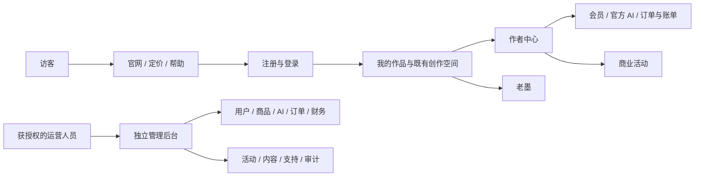
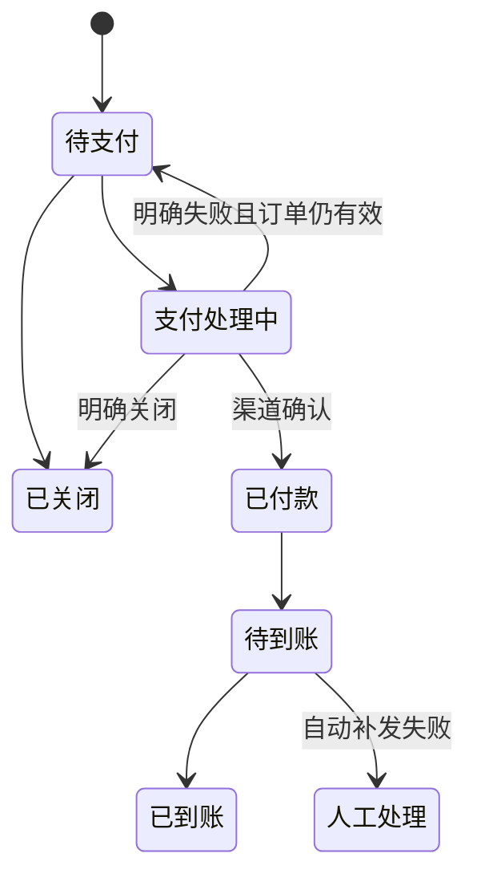

# 墨鱼上市发布 PRD

> 作者端 · 商业化 · 管理后台 · 老墨
>
> 版本：v0.3｜日期：2026-11-11｜状态：**草案，供 Vector 评审**
>
> 本文规定面向外部作者发布时需要补齐的产品能力。已确认方向、建议方案和待决问题分别标注；页面原型不等于已实现功能，本文也不构成正式定价、服务承诺或开工批准。

## 0. 本轮请先评审什么

建议先看本节、§3 首发范围、§5 收费关系和 §15 决策表，再按需要查看具体流程。作者端 15 个模块的完整需求、页面、异常与验收见[墨鱼作者端上市 PRD](author-launch-prd.md)。

**本次会话已确认：**

1. 上市需要规划管理后台和墨鱼作者端。
2. 同时支持作者自行配置 API Key，以及使用墨鱼提供的 AI 服务。
3. 商业板块服务于墨鱼自身的套餐、充值、优惠和推广活动。
4. “老墨”承载作者交流心得、分享墨鱼使用技巧等内容。本文据此按作者交流社区设计，名称及入口仍可调整。
5. 2026-11-09 补充：墨鱼就是当前 c-foundry 作者端；后台功能明确包含会员、订单、作品、费用账单、会员账户、发帖审核和用户工单。该补充确定功能范围，不等于价格、稿件访问或审核策略已定案。

**本稿的主要建议，尚待确认：**

- 作者端划分为对外了解产品的页面、既有创作空间、账户与费用、老墨；后台拥有独立入口与权限。
- 工具会员与官方 AI 用量分开核算，可组合售卖；自备 Key 不扣官方额度。
- 首发采用一个正式付费工具档、可选试用、官方 AI 用量包；先支持手动购买和续期。
- 原稿阅读、手工编辑、手工管理已有设定及导出不因会员到期或官方额度耗尽而被锁住。
- 老墨首版提供发帖、回复、搜索和内容管理。优惠活动先做简单、可核对的一套规则。
- 先邀请少量外部作者完成真实付费任务，再公开售卖；人数、周期和价格不在缺乏证据时写死。

**需要评审后才能定案：**具体权益与价格、试用政策、销售地区与支付渠道、退款政策、赠送额度有效期、社区开放方式，以及上市专项与现行范围政策的衔接。见 §15；本次新增作品支持授权和工单规则两项待决，编号 D09–D10。

## 1. 产品目标与用户

### 1.1 目标

让一位新作者能够了解墨鱼、选择 AI 使用方式、开始创作、购买合适的权益、看懂费用并获得帮助；让运营者能够解释和处理每笔交易、每次官方用量及每项社区问题。

墨鱼的核心价值仍是帮助作者管理创意、规划、设定、正文和审阅。商业化围绕真实创作任务展开，不改变作者对作品的编辑、采用、拒绝和发布权。

### 1.2 用户与任务

| 用户                 | 主要任务                           | 本稿需解决的问题                             |
| -------------------- | ---------------------------------- | -------------------------------------------- |
| 首次使用的网文作者   | 判断是否适合自己，完成一次创作任务 | 能力介绍真实、收费解释清楚、首次使用路径完整 |
| 有模型账号的作者     | 使用自己的服务商配置创作           | 配置可复用，费用由谁收取一目了然             |
| 希望开通即用的作者   | 使用墨鱼提供的 AI                  | 能看到可用模型、价格、额度、消费和失败处置   |
| 持续付费作者         | 续期、补充额度、查账、解决问题     | 订单、用量与权益对应，资金问题有明确处理入口 |
| 老墨参与者           | 学技巧、提问、交流心得             | 内容有分类、可检索，问题能获得回应           |
| 产品负责人及运营人员 | 服务作者，管理资金、活动与内容     | 有必要操作权限及可追溯记录                   |

现有种子用户是 Vector；本轮未取得外部付费需求、愿付价格、留存或获客数据。因此本文是上市能力方案，不能据此断言商业需求已验证。

### 1.3 使用环境

沿用当前桌面优先边界：创作工作台为桌面三栏，其他产品页面以不低于 1024px 的桌面使用为本轮基线。微信或支付宝扫码在手机完成付款属于支付流程，不意味着本轮承诺移动写作端。对外官网的移动浏览适配如需首发交付，单独确认范围。

## 2. 现状及已有设计的采用方式

### 2.1 已核实的代码基线

核实版本：`bda501af73947c3a693af9925419408f2931ab92`；核实日期：2026-11-08。证据种类为源码、结构和设计文件静态读取，未以此冒充真实收付款或上线验收。

| 范围           | 当前事实                                                                         | 对本 PRD 的含义                                       |
| -------------- | -------------------------------------------------------------------------------- | ----------------------------------------------------- |
| 账号           | 有注册、登录、账户安全及会话能力；用户有 `plan` 字段                             | 可复用账号基础，`plan` 本身不能代表完整订阅与交易系统 |
| 自备 Key       | `LlmConfig` 归用户所有；设置服务按用户读取并解密配置                             | 是现有使用路径，增加官方 AI 时必须保留配置与归属隔离  |
| 用量           | 有调用日志、token 汇总和作者可配置单价；存在用量未知的情况                       | 可辅助分析成本，不能直接充当正式扣费账本              |
| 商业入口       | 账户菜单中的订阅、账单、团队、邀请为禁用占位                                     | 需要真实页面、权限与服务闭环，不能只启用按钮          |
| 公开页面       | `AuthGuard` 当前仅将 `/login` 视为公开路径；`/` 转作品页                         | 官网、公开定价及帮助需要明确新增公开访问规则          |
| 商业与社区实现 | 本次指定源码范围的关键词及路径检查，未找到订单支付、订阅结算、老墨或运营后台实现 | 按新增能力规划；同名无关字符串不计作功能证据          |

具体文件、核实方式及 OpenDesign Cloud 源文件摘要见 [证据记录](commercial-launch-evidence.md)。

### 2.2 OpenDesign Cloud 已有材料

读取了 `c-foundry` 项目的完整相关页面包：`landing.html`、`pricing.html`、`billing.html`、`referral.html`，并核对 `prd.html` 与 `PROTOTYPE.md`。当前产品主页面与历史商业化材料必须分开使用。

| 设计材料                        | 可复用内容                                   | 本稿要求调整或重新确认                                                                                              |
| ------------------------------- | -------------------------------------------- | ------------------------------------------------------------------------------------------------------------------- |
| 官网 `landing.html`             | 产品说明、流程演示、价格入口、注册与登录引导 | 删除未经验证的追读率预测等承诺；不使用保证平台合规、永久免费等未确认说法；备案号等演示字段不得发布                  |
| 订阅 `pricing.html`             | 方案卡、周期选择、对比表、补充用量入口       | 原稿 ¥39/¥99、5/80/300 万字额度等均非批准定价；改为工具权益与官方用量分别解释；协作席位、指定模型等未交付能力不售卖 |
| 账单 `billing.html`             | 当前权益、用量摘要、历史订单、切换与取消确认 | 增加两种 AI 模式、待结算与退款；首版移除未具备合同能力的自动续费/绑卡展示；到期不锁已有稿件编辑                     |
| 邀请 `referral.html`            | 活动规则、分享入口、记录与发放状态           | 原稿 20% 返佣、奖励金额和示例域名未确认；与简单优惠活动分阶段处理                                                   |
| 历史 `prd.html`                 | 页面分组和创作心流原则可作参考               | 其中商业化本就标为扩展提案；社区与真实支付为当时非目标，不能据此否定本轮新需求                                      |
| 当前产品原型说明 `PROTOTYPE.md` | 当前创作壳、账户入口、四主题和品牌规则       | 保留源码对齐的现有布局；历史商业页不可直接覆盖当前产品壳                                                            |

本次项目文件清单及“老墨”“管理后台”文本检索未找到相应设计；本稿将它们列为待补设计，不把检索未命中扩张成对所有历史版本的断言。

## 3. 范围与首发定义

P0 表示**本 PRD 建议的正式首发范围**，尚未获得排期承诺。邀请付费验证可先交付其中的资金与创作闭环；只有全体 P0 通过，才可按本稿宣称首发能力齐备。

| 能力                       | 优先级 | 首发交付边界                                                                       |
| -------------------------- | ------ | ---------------------------------------------------------------------------------- |
| 官网、定价、帮助、服务说明 | P0     | 只介绍真实交付能力，公开访问，有注册和返回创作路径                                 |
| 账号与作者中心             | P0     | 会员状态、AI 来源、订单与服务概览、账户设置及我的工单                              |
| 工具会员及权益             | P0     | 会员管理覆盖注册作者；工具权益、试用、生效、续期、到期和退款变动可解释             |
| 官方 AI 计量               | P0     | 服务目录、价格、消费授权、用量明细、失败结算、余额并发保护                         |
| 支付与售后                 | P0     | 至少一个经实际接入验证的支付渠道，订单、到账、查单、退款与对账                     |
| 商业活动                   | P0     | 活动页、适用对象、时间、简单优惠码、核销记录及停用                                 |
| 老墨最小社区               | P0     | 分类、教程、发帖／回复、搜索、站内提醒、发帖审核、举报与复核                       |
| 运营后台                   | P0     | 会员、会员账户、作品、订单退款、费用账单、对账、商品活动、发帖审核、用户工单与审计 |
| 会员账户与费用账单         | P0     | 额度来源、可用／预占／退款预留、正式消费、账期汇总与调整；BYOK 估算单列            |
| 作品运营支持               | P0     | 后台作品索引、归属和服务问题关联；作者按工单选择并授权必要片段，私有正文不默认开放 |
| 用户工单                   | P0     | 私密提交、分派、回复、补充、处理结论、确认与继续反馈，关联订单／作品／动作／审核   |
| 邀请奖励                   | P1     | 推荐归因、有效邀请定义、奖励发放与撤回；另过预算与滥用验证                         |
| 年付、自动续费、复杂升降级 | P1     | 根据真实复购和渠道能力立项，不从原型直接继承承诺                                   |
| 多支付渠道、自动开票       | P1     | 首发保留明确的票据申请与进度处理；自动化能力另接入                                 |
| 高级社区功能               | P1     | 关注、私信、即时聊天、个性化推荐等根据真实需求取舍                                 |

本轮不扩展作者约稿、版权交易、资金提现、团队协作、多人工作室或无人审校整本生产；历史套餐中的这些权益不随商业页复用而进入首发。

## 4. 信息架构与页面地图

### 4.1 三种工作空间

作者中心负责账户与服务关系；创作状态和写作统计继续归既有作品页、仪表盘与工作台，避免再造一份“写作首页”。老墨从非专注创作页面的帮助/交流入口可达，位置由后续原型验证；不默认增加工作台主导航项。

### 4.2 候选页面

以下路径是**设计候选**，不是当前已存在路由。实施时与真实路由及公开访问规则一起校准。

| 页面及候选路径                               | 访问者                                 | 核心内容                                                           |
| -------------------------------------------- | -------------------------------------- | ------------------------------------------------------------------ |
| 官网 `/home`                                 | 公开                                   | 价值、真实任务演示、注册与定价；现有 `/` 行为暂保留                |
| 定价 `/pricing`                              | 公开                                   | 工具权益、官方 AI 用量价格、试用、限制、费用与售后说明             |
| 帮助与服务说明 `/help`、`/terms`、`/privacy` | 公开                                   | 入门、两种 AI 模式、收费与数据处理说明、支持方式                   |
| 作者中心 `/account`                          | 本人                                   | 当前会员、AI 模式及用量摘要、待处理订单、账户与支持入口            |
| 费用账单 `/billing`                          | 本人                                   | 额度账户、正式消费、账期汇总、来源与调整；关联订单、退款和票据     |
| 收银台 `/checkout/:orderId`                  | 订单本人                               | 商品和价格快照、优惠、有效期、支付状态与恢复查询                   |
| 商业活动 `/activities`                       | 登录作者；公开活动说明可独立分享       | 在售优惠、条件、有效期、领取和使用结果                             |
| 老墨 `/laomo`、`/laomo/posts/:id`            | 首版建议登录可读，受邀账号可发帖及回复 | 分类与搜索、帖子、回复、官方标识及举报；参与权限见 §11.2           |
| 后台 `/admin/*`                              | 具有相应操作权限者                     | 会员、会员账户、作品、订单、费用账单、发帖审核、工单及相应业务工具 |

补充候选：会员与续费 `/membership`、我的订单 `/orders` 及详情 `/orders/:orderId`、我的工单 `/support` 及详情 `/support/tickets/:ticketId`、我的帖子 `/laomo/mine` 及帖子编辑页。它们属于现有墨鱼作者端，详见[作者端设计建议](author-commercial-design.md)。

公开定价不能因“已登录”被全局跳转劫持；未登录的购买动作登录后回到原商品，再由本人确认新订单。已有支付订单仅由归属账号访问，不靠网址授权。

## 5. 工具会员与 AI 服务

### 5.1 两种模式的共同规则

| 项目               | 自备 API Key                         | 墨鱼官方 AI                                    |
| ------------------ | ------------------------------------ | ---------------------------------------------- |
| 模型服务费用收取方 | 作者选择的服务商                     | 墨鱼，按公开价格与确认规则结算                 |
| 工具权益           | 按同一会员规则判定                   | 按同一会员规则判定                             |
| 使用来源           | 显示作者配置名称和模型               | 显示官方模型/服务档及有效价格                  |
| 官方 AI 额度       | 不消耗                               | 按实际归属消耗                                 |
| 估算与正式账单     | 展示服务商成本估算及其不确定性       | 展示正式消费；可另列平台成本，但不混称作者账单 |
| 错误处置           | 引导修改配置、向服务商处理或主动切换 | 提供消费状态、重试、查账与支持                 |

一次作者动作启动时锁定 AI 来源、模型和计费规则，覆盖该动作触发的生成、分析、评审、改写及记入设定等子调用。运行中切换默认模式只影响后续新动作。任一模式失效均不自动切换到另一种付费来源，也不静默更换价位。

官方 AI 的“开通即用”仅承诺不需作者配置服务商 Key。正式可用模型清单、限制和首用引导须与交付一致，不能把历史原型里的模型名称直接列为在售服务。

### 5.2 建议的权益方案

建议首版先卖一个付费工具档，减少套餐差异对作者判断和运营的负担。下表是**待评审建议**，不是现有能力权限声明。

| 能力                                         | 基础保留状态 / 试用结束            | 正式付费工具档                   |
| -------------------------------------------- | ---------------------------------- | -------------------------------- |
| 查看、手工编辑、保存及导出自己的已有稿件     | 保留                               | 保留                             |
| 手工维护创意、规划与设定                     | 保留                               | 保留                             |
| 现有版本与已生成结果                         | 可查看和恢复既有记录；不因到期清除 | 同左                             |
| 已交付的上下文 AI 创作工作流、分析与分支能力 | 试用范围与期长待 D03 确认          | 开通；具体对照已交付功能逐项列售 |
| 自备 Key / 官方 AI 选择                      | 可维护配置；执行权限随工具权益     | 均可使用；官方用量另行核算       |
| 老墨与基础支持                               | 可使用                             | 可使用                           |
| 官方 AI 额度                                 | 独立存在；试用赠额需单独说明       | 可单买，也可随套餐附赠           |

首发不以“作品过多”锁住旧书、不以会员到期删减既有版本。新增存储、活跃作品等额度如需收费，须另定明确规则与数据恢复方式。

若官方余额尚有余款而工具权益将到期，购买前和到期前必须说明剩余额度的使用条件；提供续期、自备服务配置调整或符合售后规则的未消费购买额度退款路径。不得仅显示“充值成功”却隐藏必须另购会员的条件。

### 5.3 会员周期

建议首版支持月度手动购买与续期，不要求保存支付工具或开通代扣。支付成功且权益到账后生效；有效期内续期从原到期点延长，已到期则从本次权益生效点开始。服务月按周年日计算，目标月无该日时取月末，界面展示准确起止时间和时区。

权益失效影响新发起的付费动作；已经取得有效授权并在预算范围内运行的动作可完成。续期失败不重写历史权益记录，重复付款按不同真实订单处置，重复通知不能重复发权益。

## 6. 官方 AI 计费与用量规则

### 6.1 计费单位与展示

建议采用**可核对的模型实际用量计价**，用人民币服务额度表达可消费价值；不从生成字数反推账单，也不把“成文若干万字”当作跨任务统一用量。

同样的一章可能包含前文读取、生成、检查和记入设定。作者在发起前需要知道本次范围、预估费用及授权上限，完成后可看动作总费用和分项；token 明细作为展开项提供。

服务价格需要覆盖输入、输出，以及服务商实际区分的缓存、推理等计量项；未被该模型单独计量的项目不重复收费。金额使用足够精度累计，小额调用不逐次四舍五入放大收费；页面展示精度与扣费精度分别说明。

价格变更只作用于之后新确认的动作。订单和动作保留购买时商品、价格及规则版本，后台改价不重算历史记录。

### 6.2 额度来源

购买额度、套餐赠额、活动赠额和售后补偿分来源展示，记录发放、有效期、预占、消费、释放、退款或撤回。建议同等适用条件下先用最早到期的赠额，再用购买额度；不适用某模型的额度不计入该模型“可用”。

购买额度的有效期、可退款范围及赠额到期方式由 D05 确认，在收银台展示。赠额不可提现；本稿不引入余额转账或提现能力。运营调整使用有原因的补偿/冲正记录，不直接改写余额或删除历史。

### 6.3 一次动作的结算

1. 发起前确认来源、服务、任务范围和最高消费金额；常规动作可沿用作者显式设置的单次上限，较高或超出上限的任务单独确认。
2. 为本次完整动作预占最多可花的额度，同时计入并发任务。授权范围应包含预期的检查、记入设定和有上限的系统重试。
3. 运行时累计已知用量；超过授权范围的新增付费调用暂停并请求追加授权，不无限重试。
4. 完成后按可核对记录结算实际金额，释放剩余预占。流式输出和页面状态不构成付款凭据。
5. 中断或未知用量进入待核对，并给作者可查询的记录；需有超时处置和后台待办，不允许无限冻结额度。

作者最终结算始终不超过该动作已经明确授权的总金额。单次流式请求在结束后才回报用量，或推理、缓存等计量项使实际成本超出剩余授权时，超出部分由平台承担；保留已经交付的结果，不事后强制追加授权、不从其他余额或后续充值追扣。

同一动作的子调用并发也共享该总上限，不能各自将整个动作上限当作可花预算。启动前按可核实的输入及最大输出等计量边界判断费用上界；无法核实上界的服务须有独立的平台成本保护及验证证据，否则不上架正式收费。作者授权上限与平台控制上游成本分别验收，前者不依赖服务商恰好及时返回用量。

预占仅是消费授权，不是已消费；作者可看到可用、预占和已结算金额。异常恢复不得重复结算同一服务调用。

| 情况                                           | 建议的作者收费结果                                                               |
| ---------------------------------------------- | -------------------------------------------------------------------------------- |
| 未调用模型即拒绝、排队取消                     | 不收费，释放预占                                                                 |
| 平台或服务商失败且无可用结果                   | 不向作者收费；平台承担已经发生的上游成本                                         |
| 作者主动中止，已有可保留的部分结果及可核对用量 | 按事前说明结算已发生部分，不超过授权上限                                         |
| 作者中止但用量暂未知                           | 先待核对；建议 24 小时内补取，仍无法核实则释放预占，平台承担不确定成本           |
| 系统重试或质量修复                             | 限于已告知的范围与总上限；平台技术失败重试不额外转嫁；作者主动重新生成属于新动作 |
| 有可用正文，某个后续分析或记入设定步骤失败     | 按成功分项结算；失败项不收费，结果显示部分完成与补做方式                         |
| 结算系统故障、重复消息或进程恢复               | 进入对账；不丢稿，不重复扣费，不让作者自行反复支付                               |

完整失败的服务动作不得仅凭“上游已消耗”向作者扣费。质量偏好不合意与技术失败需要区分：已成功交付且用量可核对的候选通常计费，墨鱼不承诺“作者不喜欢就自动全额免费”；争议有支持入口和审计依据。

### 6.4 与现有创作安全规则衔接

- 余额不足时，在新官方付费动作开始前说明缺口，提供充值、主动切换自备 Key 或返回手写的路径。
- 自动保存不触发付费 AI，不因余额或会员状态失败。
- 发布、冻结、版本归属及提议确认规则保持有效。未执行的回流不得标成成功，不因收费失败清空已有连续性记录或绕过既有发布规则。
- 一个含记入设定的完整动作应在开始时预留这部分预算；单独触发发布时按当次真实路径说明所需动作，保留原有明确的回流失败恢复语义。
- 官方 AI 上线前，逐条核查所有可触发模型的入口，包括后台任务与重试；没有可靠归因、用量或授权边界的入口不能转为正式收费。

## 7. 支付、到账与售后

### 7.1 购买流程

作者选择商品 → 核对权益及用量有效期 → 校验优惠 → 创建本人订单 → 选择已接入渠道付款 → 服务端确认 → 发放权益/额度 → 显示到账结果与订单入口。

收银台必须显示商品、服务期限或额度、原价、优惠、实付、支付方式、订单号、截止时间及售后说明。优惠由服务端复核，作者刷新或换设备后仍能查询本人订单。

首发建议从微信支付、支付宝中选择至少一个实际可开通并验证的渠道。当前未核实商户主体、合同及接入条件，PRD 不宣称已支持任何渠道。票据首版可采用申请和人工处理，但必须能展示受理状态及联系路径，不能把“下载账单”冒充正式发票。

### 7.2 支付和履约分开显示

“已付款/待到账”必须保留为可恢复状态。关闭、超时和失败是当前订单状态，迟到的真实付款仍需查单及对账：验证后补发或原路退款，不吞款、不重复建权益。一个订单存在多个付款尝试时分别记录，只发放一次。

同一订单只选择一个经验证的有效成功付款承担履约。其他付款尝试若也真实扣款成功，必须逐笔关联并原路退回全部多收金额，不得当作重复通知忽略。退款未知或失败进入财务待办并持续对账，直到每一笔真实收款都有唯一履约或明确退款归属；不要求作者再次提供付款来解决多收款。

支付页面返回成功不直接发权益；网络超时不直接判付款失败。用户通过查询恢复，不通过创建新订单猜测旧单是否成功。后台和渠道同时重试、重复或乱序通知，均不得重复发放。

### 7.3 退款

作者可从订单提出退款/费用异议，查看原因、处理状态和到账结果；财务可审核、执行、复查及重试。客服不能直接确认资金已退。

首发规则建议：未消费的购买额度可按订单归属申请退款；已消耗部分、赠额和工具服务期间分别核算，具体适用条款由 D05 确认。不得从余额表面数字推定某一订单仍可退金额。

退款受理时预留对应可退额度，防止等待过程中又被消费；不能冻结其他订单或无关稿件。退款明确失败后释放相关预留；明确成功后冲正对应权益/额度。结果未知时保留处理中并对账，不能让资金已退而权益仍可无限消费，也不能把未确认退款当成已完成。

对于已开始使用的工具会员，退款后权益截止、随单赠额及已消费赠额的处置必须在销售前定案。首发不自动追收成负余额，不把他人赠额、旧余额或新充值拿来填补规则未定义的缺口。

## 8. 作者页面要求

完整作者端 PRD 见 [author-launch-prd.md](author-launch-prd.md)，覆盖会话整理的 AP-01–AP-15 和 AA-01–AA-19；本节保留总览和原有 AU 编号。共同商品、资金、社区和支持授权规则及 D01–D10 仍以本总 PRD 为准，页面布局稿是设计投影。

| 编号  | 页面/能力          | 核心要求                                                                                         |
| ----- | ------------------ | ------------------------------------------------------------------------------------------------ |
| AU-01 | 官网               | 围绕真实作者任务介绍功能，演示与实机能力一致，关键价格和限制可找到                               |
| AU-02 | 作者中心           | 会员、AI 来源、额度和待处理事项分开；有继续写作、订单、账单与工单入口                            |
| AU-03 | 定价               | 清楚区分工具费和官方用量，标注试用、有效期、前置会员要求和未包含项目                             |
| AU-04 | 费用账单与账户     | 按时间、作品、动作查正式消费与账期；购买／赠额／补偿、任务预占和退款预留可核对，BYOK 估算单列    |
| AU-05 | 订单与售后         | 看价格快照、付款和到账状态、退款、支持及票据申请；可导出本人账单                                 |
| AU-06 | AI 来源            | 设置中保留自备配置管理；官方服务可查看和选择；切换说明何时生效及费用归属                         |
| AU-07 | 帮助与工单         | 从订单／作品／动作／审核结果创建私密工单，跟踪答复、补充、确认解决或继续反馈；材料按范围主动授权 |
| AU-08 | 我的作品与支持授权 | 复用既有作品管理；查看本书费用、关联故障工单，预览和撤销支持材料后续访问授权                     |
| AU-09 | 我的帖子与审核     | 查看草稿、提审和公开版本、审核结果及理由；修改重提、撤回和申请复核                               |
| AU-10 | 会员与我的订单     | 会员权益和官方额度分别购买；订单与正式消费独立成页并可互相追溯                                   |

作者端信息架构和首轮页面详见[作者端设计建议](author-commercial-design.md)。会员／订单／账单／工单集中在账户与服务区域；老墨有独立交流入口，创作仍由当前作品与工作台承接。

新页面复用现有墨鱼设计系统与四主题。品牌、字体、朱砂与状态色按根 `DESIGN.md`；异常配文字与操作，不仅用颜色区分。需要键盘可达、明确焦点、可读金额与时间，界面展示作者可理解的动作名称。

## 9. 管理后台

后续设计输入见 [后台设计 Brief](admin-design-brief.md)、[页面地图](admin-page-map.md)、[作者端设计建议](author-commercial-design.md)及[跨端业务流程](commercial-cross-app-flows.md)。墨鱼作者端就是当前 c-foundry 项目；这些设计准备不表示本稿待决商业规则已获批准。

### 9.1 后台目标与权限

后台帮助运营解决问题、控制服务成本和履行售后。用户稿件不成为默认可浏览的运营资产，账号费用查询不附带阅读正文或获取 Key 的权限。

建议采用固定职责，首位运营者可由同一人兼任；不在首版建设自定义角色编辑器。

| 职责      | 允许处理                                                    | 关键限制                                                 |
| --------- | ----------------------------------------------------------- | -------------------------------------------------------- |
| 负责人    | 授予后台权限、审核商品与规则、全部业务管理                  | 高影响改价、补偿和权限变更有明确确认及审计               |
| 客服/运营 | 查询用户、权益、订单和动作状态，提交补偿/退款申请，维护活动 | 不查看完整 Key，不直接确认付款或退款成功，不任意编辑余额 |
| 财务      | 支付退款、对账、账务导出和补偿审批                          | 不据客户端截图直接发权益，不修改或删除原始交易记录       |
| 内容管理  | 官方教程、帖子回复、举报、禁言和恢复                        | 社区禁言不等同于封停写作、资金或导出功能                 |

每个后台接口均验证相应权限；后台账号撤权后，已有会话也不能继续执行原权限操作。查看敏感数据、导出和资金调整均留可追溯记录。

### 9.2 模块与操作

| 编号  | 模块           | 首发所需操作与信息                                                                                                       |
| ----- | -------------- | ------------------------------------------------------------------------------------------------------------------------ |
| AD-01 | 待办与总览     | 待到账、退款未知、用量待核对、对账差异、举报；收入/退款/官方成本分开看并标明未知                                         |
| AD-02 | 会员与权益     | 管理全部注册作者，按免费／试用／付费权益等筛选；查询账号、权益时间线，关联账户、作品、订单及工单；社区限制与账号安全分开 |
| AD-03 | 商品与定价     | 草稿、审核、生效、下架；商品权益及价格版本；已售订单保持原规则                                                           |
| AD-04 | 官方 AI 服务   | 发布/停用服务、维护在售模型与价格、查看调用成功率和成本；未知成本单列；限流与故障恢复                                    |
| AD-05 | 订单与退款     | 查单、核对、补发、原路退款与失败重试；付款凭证与履约记录关联                                                             |
| AD-06 | 财务与对账     | 渠道收款、退款、权益/额度发放、AI 消费、赠额与冲正对应；差异有归属、处理状态及说明                                       |
| AD-07 | 商业活动       | 活动、优惠码、预算、适用人群、使用上限、核销与停用                                                                       |
| AD-08 | 社区内容       | 官方教程、分类、精选、举报、隐藏／恢复、禁言与复核；与发帖审核共同管理公开内容                                           |
| AD-09 | 用户工单与审计 | 私密问题受理、分派、回复、补充、结论、作者确认和继续反馈；内部备注分开；按人、对象、时间、原因追溯                       |
| AD-10 | 作品管理       | 作品索引、归属、管理信息及必要统计；关联任务、费用与工单；正文等私有材料仅按作者明确授权的范围查看                       |
| AD-11 | 会员账户       | 购买／赠额／补偿分来源，查看可用、任务预占、退款预留、到期与变动；退款、更正、补偿走有依据的业务操作                     |
| AD-12 | 费用账单       | 按会员、账期、作品、动作核对正式消费及调整；与订单、账户及原始明细关联，平台成本与 BYOK 估算分开                         |
| AD-13 | 发帖审核       | 待审队列、版本预览、通过／退回及理由、撤回、重提与复核；阻止已过期或撤回版本被再次公开                                   |

服务暂停或下架只阻止新官方动作，已授权任务按明确规则完成或取消退款；已购买额度仍可查询和按政策处理。全站故障不通过无痕更换模型或清零用户记录解决。

### 9.3 会员、会员账户、订单与费用账单的边界

会员管理覆盖全部注册作者，工具会员是其中的服务权益维度。会员账户展示某位作者的权益与官方 AI 服务额度，区分购买、赠送、补偿、任务预占及退款预留；账号安全和社区参与状态各自管理。它不新增可提现余额、转账或用户资金理财能力。

订单记录购买与支付、履约和售后；费用账单记录服务消费、账期和调整。账期按已入账变动核对期初和期末；预占／退款预留影响可用额度，不重复计入已消费。订单、账户、账单和明细使用同一来源，不能各自维护一个会漂移的余额；BYOK 估算不加入墨鱼正式消费，平台收款和上游成本也不混入作者消费合计。

### 9.4 作品管理与支持访问

后台作品管理先提供作品标识、归属、标题、形态、管理状态、更新时间、必要的章节／字数统计及费用／技术任务／工单关联；字段来源在实施前核实。运营索引不等于阅读权，不将生成量当作作品质量，也不把当前创作中的发布／冻结状态解释为公共上架状态。

客服确需私有材料时，由作者在私密工单中选择明确片段或快照，预览用途、可访问职责和有效范围后主动授权。查看行为留痕，撤销或过期后不得继续读取；不会随新章节自动扩大为整本访问。访问与留存规则由 D09 定案。后台不默认代编辑正文、解冻、删除作品、转移归属或整本导出。

### 9.5 发帖审核与用户工单

发帖审核模块是用户明确要求；本稿建议帖子先审后公开，是否也审核回复由 D07 定案。审核针对送审版本并记录操作者、结果和理由，修改重提后重新审核；旧审核请求不能公开已撤回或过期版本。已公开帖修改时，旧公开版与新候选分开，候选审核失败不覆盖旧版；管理员隐藏或作者撤回仍立即作用于公开可见性。

用户工单承接会员、支付、费用、作品／AI 故障、社区复核及建议。首版支持私密创建、业务对象关联、分派、双方回复、待补充、已答复待确认、解决与关闭；未解决可继续反馈，关闭后重开和响应时效由 D10 定案。作者可见答复与内部备注隔离，资金与权益动作仍经相应业务权限执行，不因工单改状态而变成已退款。工单不自动发布为老墨求助，首版任意附件上传范围另评估。

## 10. 商业板块与推广

商业板块集中展示墨鱼自身套餐、充值包和活动。作者能看到可参加的活动、规则、期限、领取结果及使用记录；运营能解释优惠为什么有效或无效。

首发建议仅支持一种简单优惠码：适用于指定商品的固定金额优惠，每单最多一个，优惠后金额必须在渠道支持范围内。明确有效期、适用账号、总量、每人次数和预算；创建待支付订单时暂占名额，订单关闭释放，付款成功核销，退款不自动恢复为可再次套利的优惠资格。

修改活动不回写已确认订单。过期、无资格、用尽或已使用分别说明；不能先显示折后价再在付款后要求补差额。后台有停用开关与核销记录，订单关闭迟付沿用 §7 的查单处置规则。

关闭订单前先查明支付状态；仍未知时不以本地超时作为释放名额的依据。若名额及预算已经释放后核实真实迟付，补发前必须重新满足活动资格并原子取得所需名额与预算，随后按原订单价格履约；不能重新取得时，按原实付金额全额原路退款并解释原因。不加价、不静默超预算，也不夺回其他订单已经取得的优惠。涉及多笔成功付款时，同时遵守 §7.2 的逐笔退款规则。

邀请页可以在 P1 复用：先确定有效邀请、奖励种类、发放时点、预算、退款撤回及防滥用，再开放。原型中的现金返佣率、按月结算和收益账户不作为首发承诺。

## 11. 老墨：作者交流与使用经验

### 11.1 首版内容与边界

建议三个分类：**墨鱼使用技巧、创作心得、问题求助**。官方教程与公告带明确标识；作者昵称、社区内容与个人账务身份分别呈现，不公开邮箱、真实支付姓名、会员账单或作品库。

| 编号  | 能力       | 首版要求                                                                             |
| ----- | ---------- | ------------------------------------------------------------------------------------ |
| LM-01 | 浏览与搜索 | 分类、时间排序、标题/正文检索、官方及精选筛选；无内容时引导看入门材料或提问          |
| LM-02 | 发帖       | 标题、分类、正文、预览、发布及草稿恢复；首版支持文本和安全格式，不依赖附件上传       |
| LM-03 | 回复       | 回复帖子或引用一条回复，使用清楚的上下文；可修改或撤回本人内容                       |
| LM-04 | 站内提醒   | 回复、管理处置和官方答复可查看并定位；不新增短信、邮件群发或私信                     |
| LM-05 | 举报与管理 | 选原因、提交、查看处理进度；内容管理员可隐藏、恢复及禁言，保留理由与必要审计         |
| LM-06 | 官方运营   | 维护入门教程、常见问题与精选经验，产品变化后能更新并显示更新时间                     |
| LM-07 | 发帖审核   | 我的帖子可查送审版本、进度和退回理由；修改重提、撤回、公开版修改和审核并发有恢复路径 |
| LM-08 | 私密复核   | 作者能由审核或处置结果创建私密工单，不被迫公开问题或私有材料                         |

社区不自动读取或公开作者作品。分享作品片段由作者主动复制/选择、预览并确认公开；产品不把“公开求助”当技术支持的唯一方式。模型或智能助手代拟的帖子不得冒充真实作者心得。

### 11.2 内容生命周期与恢复

建议首批登录作者可读，先邀请少量账号发帖，结合频率限制、举报与人工管理；验证回应及管理负担后再开放注册账号发帖，具体方式由 D07 确认。

邀请写权限同时覆盖发帖与回复。未受邀账号仍可浏览、搜索、举报及查看与本人有关的站内管理提醒；发帖和回复入口说明参与条件，不开放可提交的新草稿。已有草稿及本人内容始终按账号隔离，撤销参与权限不自动公开或删除草稿；恢复权限后可继续编辑。限制由服务端执行，不能仅靠隐藏入口。

帖子建议经历草稿、待审核、退回修改、公开、作者撤回或管理员隐藏；公开版与修改待审候选分开。后台审核通过才将相应送审版本公开，具体先审策略由 D07 裁决。回复审核策略单独确认；回复同步保留其上下文，原帖不可见时说明原因，不泄露被隐藏正文。搜索结果、引用与通知遵守相同可见性。作者能查看自己的处置理由并提出复核，社区禁言只限制社区互动。

发帖超时先查询是否成功，避免重复发帖；草稿恢复按账号隔离。社区故障不影响稿件保存、写作或账单查询。撤回、删除、审计留存期限和账号注销后的处置，在公开规则中与私有稿件分开说明，发布前落实。

上线前准备真实入门材料、费用说明、常见失败恢复及一批可使用的经验内容；数量按实际准备情况核实。需要指定负责回复求助和处理举报的人，不能用空分类替代交流服务。

## 12. 关键状态与失败恢复

| 场景                   | 作者看到什么                             | 可采取的下一步                             |
| ---------------------- | ---------------------------------------- | ------------------------------------------ |
| 首次使用，尚未选择 AI  | 两种方式及各自费用说明                   | 选择官方服务或配置自己的 Key；继续手工创作 |
| 官方额度不足或会员到期 | 明确是工具权益还是官方额度不足           | 续期、充值、主动换来源或返回稿件           |
| 支付中断、网络超时     | “正在确认付款”，显示订单号               | 查询旧单；确认关闭后再决定重买             |
| 已付款未到账           | “已付款，权益发放中”，显示处理入口       | 自动补发、主动查询、提交支持               |
| AI 部分完成            | 已保留结果、失败步骤、实际消费及剩余预占 | 使用已交付结果；单独确认补做               |
| 用量或退款未知         | 待核对，说明冻结范围与预计处理时间       | 查看进度及联系支持；其他可用功能继续       |
| 优惠无效               | 具体的失效原因，保留商品选择             | 换有效优惠，或明确接受原价后再付款         |
| 社区无结果或发帖失败   | 空态、检索建议、保留草稿                 | 调整检索、重试、确认是否已发布             |
| 内容被隐藏或禁言       | 具体规则、期限及复核入口                 | 修改内容/申请复核；继续私人创作            |
| 后台操作失败           | 未确认成功，不伪造到账或退款反馈         | 保留处理对象，查询真实状态后重试           |

支付、AI 和社区各自故障时保持边界，不能通过整站只读或阻止保存来规避处理。持久化、支付和发布的成功反馈分别来自各自可核对结果。

## 13. 验收与成功判断

### 13.1 首发验收场景

| 编号  | 必须验证的任务                                                                | 通过标准                                                                                                       |
| ----- | ----------------------------------------------------------------------------- | -------------------------------------------------------------------------------------------------------------- |
| AC-01 | 未登录了解定价并购买                                                          | 价格可读，登录后商品意图保留，订单由本人最终确认                                                               |
| AC-02 | 自备 Key 完成含检查/记入设定的动作                                            | 所有子调用保持来源归属，不出现官方扣费                                                                         |
| AC-03 | 官方 AI 完成同类动作                                                          | 事前授权、分项用量、实际结算与释放预占相符                                                                     |
| AC-04 | 并发动作、同动作子调用并发、流式结束后才回报用量，及推理/缓存计量导致实际超额 | 作者结算不超本动作授权、不重复占用或产生负余额；超额由平台承担，结果保留，不事后追扣；平台成本保护单独验证     |
| AC-05 | 失败、中止、部分完成和未知用量                                                | 结果保留、收费及恢复符合 §6；待核对超时有处置                                                                  |
| AC-06 | 支付成功、回调丢失/重复/迟到，以及同订单不同支付尝试均成功                    | 只发一次权益；每笔真实成功付款都有唯一履约或原路退款归属；多收退款未知/失败可恢复，不被当成重复通知忽略        |
| AC-07 | 退款中继续消费、退款未知与失败                                                | 仅预留相关额度；确认结果后资金与权益一致                                                                       |
| AC-08 | 会员到期、余额耗尽及运行中到期                                                | 旧稿读编导可用，已授权动作按规则完成，新增动作提示准确                                                         |
| AC-09 | 已购商品后改价、下架或停活动                                                  | 历史订单/消费不被重算；剩余额度有处置路径                                                                      |
| AC-10 | 他人访问订单、消费、Key、社区草稿；后台越权                                   | 服务端拒绝，前端隐藏不作为唯一保护；撤权及时生效                                                               |
| AC-11 | 优惠并发核销、关闭释放、退款，以及释放后名额已被占用又发生迟付                | 可重新取得资格/名额/预算才按原价履约，否则全额原路退款；不超预算、不加价、不夺回他人优惠；支付未知时不贸然释放 |
| AC-12 | 老墨受邀权限、发帖审核、草稿、公开版修改、搜索、举报与提醒                    | 未受邀不能新提审／回复；审核版本可追溯，待审和隐藏内容不泄露，撤回或过期版本不被旧审批公开                     |
| AC-13 | 社区故障和内容禁言                                                            | 私人创作、保存、账单与导出不受社区状态误伤                                                                     |
| AC-14 | 桌面关键页面、四主题与键盘操作                                                | 金额/状态清楚，焦点可见，错误可恢复，回到创作不丢上下文                                                        |
| AC-15 | 运营定位一个异常付款与一次费用争议                                            | 可关联订单、支付、权益、动作及处置记录，形成闭环                                                               |
| AC-16 | 会员账户、账期汇总与订单／消费明细互查                                        | 期初期末及已入账变动可核对，预占／退款预留不重复算消费；BYOK 与平台成本不混入正式消费                          |
| AC-17 | 后台作品定位与工单材料授权、过期和撤销                                        | 能定位归属及关联问题；私有材料仅在有效授权范围内访问，撤权、过期和版本变化不扩大权限                           |
| AC-18 | 发帖退回重提、公开版修改、撤回与管理员并发审核                                | 审核理由和版本清楚；旧公开版与候选分离；撤回、禁用或旧版本审批不造成误公开                                     |
| AC-19 | 用户工单提交超时、补充、交接、确认和继续反馈                                  | 原问题可恢复，回复输入保留，内部备注隔离；作者未确认解决时不能假称已确认，关联资金结果真实                     |

验收同时需要合适的自动检查、支付渠道测试环境证据、实际桌面任务走查，以及负责人确认的真实小额购买/退款验证。真实资金验证在对应接入完成后执行；本次 PRD 编写不执行收款、退款或商户配置。

### 13.2 运营指标

| 指标               | 明确口径及用途                                                                           |
| ------------------ | ---------------------------------------------------------------------------------------- |
| 首次有效使用       | 新外部作者独立完成一个自己认可的创作任务；注册、模型出字不自动算完成                     |
| 付费与继续使用     | 有实际成功支付并履约，之后持续使用；测试账号、测试订单、退款单分别标识                   |
| 付款履约差异       | 渠道已收款但未正确发权益，以及已退资金但未正确冲正的记录；上线前复核场景不能有未解释差异 |
| AI 收入与成本      | 实际确认的作者消费、对应上游成本及未知项分开看；充值收款不直接当作 AI 使用利润           |
| 费用争议与支持负担 | 因收费不清、重复扣费、用量未知等产生的问题量和解决时间                                   |
| 老墨有效帮助       | 求助是否得到有效回应、作者是否确认解决、教程是否帮助完成任务；帖数不能替代价值           |

数值目标在邀请验证前由负责人确定。上线人数、付费转化、毛利、响应时间与作品质量均不在本稿虚构基线。商业指标不能替代既有作品验收，也不从生成字数推断作者接受。

## 14. 推进顺序、依赖与发布门

### 14.1 建议分阶段交付

| 阶段                  | 交付物                                                                   | 退出条件                                                               |
| --------------------- | ------------------------------------------------------------------------ | ---------------------------------------------------------------------- |
| A：规则与设计评审     | 本 PRD、权益/价格表、支付与售后规则、现有设计差异及新增页面流程          | §15 中影响收款和履约的决策有明确结论；可按任务走完原型                 |
| B：商业地基           | 身份与工具权益、会员账户、AI 来源、正式账务与授权、商品版本、对应后台    | 核心不变量通过，账户与费用可核对；不在此阶段开放真实售卖               |
| C：付费闭环与邀请验证 | 官网／作者中心／收银台／订单／账单、支付退款对账、作品支持索引与私密工单 | 作者能独立购买和创作，小额支付退款及支持任务验证通过；私有材料访问受控 |
| D：商业活动与老墨     | 简单活动优惠、社区与发帖审核、内容后台、首批内容及负责人                 | 核销、提审重提、公开版本、举报复核和异常恢复通过                       |
| E：公开首发           | 全部 P0、服务说明、支持安排及上线结果回看                                | A–D 的证据齐备，未决事项不再影响对外承诺；负责人决定开放范围           |

阶段可在依赖满足后并行推进，但正式首发不能把尚未交付的 P0 写成已上线。任何阶段未过门均记录阻塞事实和负责人，不用一个笼统“开发完成”替代资金、产品和运营验收。

### 14.2 与仓库政策衔接

现行定位和 compass 分支使命对运营后台、平台化扩张及 FINAL 外新入口有明确范围限制。本次会话已授权上市方向讨论和 PRD 编写；**未授权在本轮修改既有政策、冻结 FINAL、生成策略、数据库或生产入口**。

PRD 评审后，将获准的上市专项范围追记到定位/分支准入，保留作者主权与创作安全约束；随后按统一 OpenSpec 工作流拆成可独立验收的 change。官方 AI 的费用控制与原“用量仅供预算、不拦生成”契约存在差异，需要显式 delta，不能直接改现有成本页语义。

建议后续按“权益与身份 / AI 来源与计费 / 支付履约与售后 / 作者页面与官方介绍 / 活动 / 老墨”拆交付，后台能力随对应业务一起落地。本文不是新增平行生成器、通用权限平台或大型计费框架的立项依据。具体代码落点在各 change 开工前一手核实到文件，不能用本稿的页面候选代替影响分析。

外部依赖包括可用商户及支付渠道、在售模型用量可核对性、服务价格与退款规则、真实作者验证对象、支持与社区管理人手。未核实的外部条件保留为依赖，不从历史原型推断已经满足。

## 15. 待 Vector 裁决的事项

下表是本稿评审清单。未选择的建议仍为草案，不会因文档完成而自动生效。

| 编号 | 决策                           | 本稿建议                                                                                                                   | 不定案的影响                                   |
| ---- | ------------------------------ | -------------------------------------------------------------------------------------------------------------------------- | ---------------------------------------------- |
| D01  | 邀请付费验证与正式首发的范围   | 先完成 C 阶段邀请验证，正式首发包含全部 P0                                                                                 | 无法确定公开销售的验收门及社区何时上线         |
| D02  | 首发销售地区、币种、支付及票据 | 先以实际商户可支持的一个市场、人民币和一个渠道闭环；渠道以核实结果选定                                                     | 收银台、退款、时间展示与对外服务说明无法定案   |
| D03  | 工具档、试用及正式权益/价格    | 一个正式工具档、可选试用；读编导保留；在真实作者和成本取证后填金额及完整权益清单                                           | 不可正式售卖，也不可擅自锁掉现有工作流         |
| D04  | 官方 AI 的计价与消费确认       | 实际可核对用量、动作总上限、无静默来源切换、平台技术失败不向作者收费                                                       | 无法确定作者费用承诺、预算及界面文案           |
| D05  | 额度有效期、退款及随单赠额处置 | 购买/赠送分来源；不做负余额追收；未知用量建议 24 小时后由平台承担；最终售后规则销售前公示                                  | 财务和履约规则不完整，不能接收真实付款         |
| D06  | 优惠与邀请                     | P0 简单固定金额优惠码；P1 再开放邀请奖励，不继承历史现金返佣                                                               | 决定活动后台、核销与奖励成本范围               |
| D07  | 老墨开放、审核策略与运营人手   | 登录可读、邀请写；建议帖子先审后公开，公开版与修改候选分开；回复是否先审单独定，指定审核／回应／举报负责人                 | 决定参与权限、待审流程、可见性与管理负担       |
| D08  | 上市专项的准入与实际产品版本   | PRD 批准后单列范围例外，再按 release-train 和 OpenSpec 分阶段实施；不默认纳入当前版本 Must ship                            | 治理、开发分支、排期和对外版本声明不能定案     |
| D09  | 作品支持授权与材料留存         | 默认仅运营索引；正文按工单由作者选择版本／片段主动授权，限定职责、范围和有效期，允许撤销后续访问；留存与清理规则销售前明确 | 决定客服可读内容、作者授权界面及审计／清理边界 |
| D10  | 工单服务规则                   | 私密文本与业务关联先行；可补充、交接、确认和继续反馈；响应时效、关闭后重开及附件范围按实际人手定案                         | 决定状态、通知、服务承诺和支持负担             |

**建议的下一项现实验证：**用本稿权益表和现有设计，邀请至少一位真实外部作者，在不代操作的情况下走完“了解费用 → 选择 AI 来源 → 选择服务 → 完成创作任务”的原型流程，记录他对付费对象、费用和失败恢复的理解；将愿付金额与实际付款分开记录。验证对象由负责人安排，本次不对外联系或发送邀请。

## 16. 本稿的交付状态

- 已完成：v0.1 静态核对与建议；v0.2 补充七项后台能力及作者端对应设计；v0.3 生成独立的[作者端上市 PRD](author-launch-prd.md)，细化 15 个模块、页面、异常、后台配合和验收。v0.2–v0.3 新增内容仍待评审。
- 待完成：Vector 评审、§15 决策、商业验证、增量原型设计和后续 OpenSpec。
- 本次未实施：生产代码、数据库、支付/模型配置、正式价格、权限策略及现有设计文件修改。

本稿只新增规划文档，不改变已冻结 FINAL，不把历史原型的示例价格与能力当作已批准产品事实。

> 下方独立评审结论仅适用于 2026-11-08 的 v0.1；v0.2–v0.3 新增范围及作者端 PRD 尚未重新独立评审，不继承原 PASS。

<!-- gstack:office-hours:concerns:start -->

## Reviewer Concerns

Disposition: COMPLETED

Stop: PASS

No unresolved findings.

<!-- gstack:office-hours:concerns:end -->

2026-11-11 v0.3：按用户“生成 PRD”的要求，将已讨论的 15 个作者端模块形成独立作者端 PRD；保留总稿的共同规则与 D01–D10 决策权威，不改变生产准入或待定商业条款。
